# Lab 2: A secure hot-warm OpenSearch 3.8 cluster, log lifecycle and monitoring

Everything in this lab is one Ansible playbook, `ansible/lab2.yml`. A run against a clean Ubuntu 22.04 VM gives you:

- a three-node OpenSearch 3.8.0 cluster (two hot nodes, one warm), TLS on both the REST and the transport layer, and OpenSearch Dashboards over HTTPS;
- three users with their own roles: one can only write logs, one can only read them, one can only read metrics;
- an nginx page that writes JSON access logs, Fluent Bit shipping them into the `logs-nginx` data stream, an index template, and an ISM policy that rolls the index over at 1 MB or 1 minute (in practice about every two minutes, see [6.5](#65-does-deletion-really-happen)) and deletes it after 10 minutes;
- the OpenSearch Prometheus exporter plugin, Prometheus and a provisioned Grafana dashboard.

Docker was allowed for this lab, but I kept the approach from lab 1: every component is installed from its official archive or repository and runs as a systemd service. With three OpenSearch nodes on one machine this meant solving several things by hand that a container image normally hides (per-node configuration directories, JVM paths, kernel settings, certificates). Those turned out to be the most instructive parts of the lab, and I describe them in [what actually took time](#9-what-actually-took-time).

Each part has its own Ansible tag, and almost every change is followed by a task that reads the state back from the cluster and asserts it. A green `changed` only says that a request was sent; the read-back says that the cluster really ended up where I wanted.

## Contents

1. [Requirement coverage](#1-requirement-coverage)
2. [Environment and architecture](#2-environment-and-architecture)
3. [Running it](#3-running-it)
4. [Part 1: deployment and TLS](#4-part-1-deployment-and-tls)
5. [Part 2: role model](#5-part-2-role-model)
6. [Part 3: logs, template and ISM](#6-part-3-logs-template-and-ism)
7. [Part 4: monitoring](#7-part-4-monitoring)
8. [Load test](#8-load-test)
9. [What actually took time](#9-what-actually-took-time)
10. [Limitations and what I would change](#10-limitations-and-what-i-would-change)

## 1. Requirement coverage

| # | Requirement | Where | Evidence |
|---|---|---|---|
| 1 | Hot-warm OpenSearch cluster | `opensearch` role, `opensearch_nodes` in `opensearch_common/defaults` | [4.1](#41-three-nodes-on-one-host), screenshot 04 |
| 1a | TLS on the transport and REST layers | `certificates.yml`, `opensearch.yml.j2`, `verify.yml` | [4.2](#42-tls), screenshot 05 |
| 1b | Dashboards | `dashboards` role | [4.3](#43-opensearch-dashboards), screenshot 06 |
| 2.1a | Writer role: write only into the logs data stream | `lab2_logs_writer` | [5](#5-part-2-role-model), screenshots 07, 17 |
| 2.1b | Reader role: read only `logs*` | `lab2_logs_reader` | [5](#5-part-2-role-model), screenshot 17 |
| 2.1c | Monitoring role with minimal rights | `lab2_monitoring` | [5](#5-part-2-role-model), screenshots 17, 22 |
| 2.2 | Three users with these roles | `security_users` | [5](#5-part-2-role-model), screenshots 08, 09 |
| 3.1 | nginx page with JSON logs | `nginx.yml` | [6.1](#61-nginx-writes-json), screenshots 10–12 |
| 3.2 | Log shipper nginx → OpenSearch | `fluentbit.yml` (Fluent Bit) | [6.2](#62-fluent-bit), screenshots 15, 16 |
| 3.3 | Index template for the nginx logs | `template.yml`, `index-template.json.j2` | [6.3](#63-index-template-and-data-stream), screenshot 14 |
| 3.4a | Logs are kept for 10 minutes, then deleted | `ism-policy.json.j2` | [6.5](#65-does-deletion-really-happen), screenshots 18, 19, 21, 32, 35 |
| 3.4b | Rollover at 1 MB or 1 minute, whichever comes first | `ism-policy.json.j2` | [6.4](#64-ism-policy), screenshots 13, 20, 33, 34 |
| 4.1 | Prometheus plugin for OpenSearch | `opensearch_plugins_install`, `plugin.yml` | [7.1](#71-exporter-plugin), screenshots 22, 23 |
| 4.2 | Useful metrics | dashboard JSON | [7.3](#73-which-metrics-and-why) |
| 4.3 | Dashboard | `grafana.yml` | [7.2](#72-prometheus-and-grafana), screenshots 24–27 |

## 2. Environment and architecture

| Component | Version / setting |
|---|---|
| VM | Ubuntu 22.04.5 LTS, 4 vCPU, 7.7 GiB RAM, disk extended from 40 GB to 80 GB |
| Ansible | ansible-core 2.21.5 in a virtualenv, collections `community.crypto 3.5.1`, `ansible.posix 2.2.2` |
| OpenSearch / Dashboards | 3.8.0, official tar.gz archives, checked against the published SHA-512 |
| Prometheus exporter plugin | 3.8.0.0 (must match the OpenSearch version exactly) |
| nginx | Ubuntu package, port 8080 |
| Fluent Bit | 5.1.5 from the official APT repository |
| Prometheus / Grafana | 3.15.0 / 13.2.3 OSS, both pinned with SHA-256 |

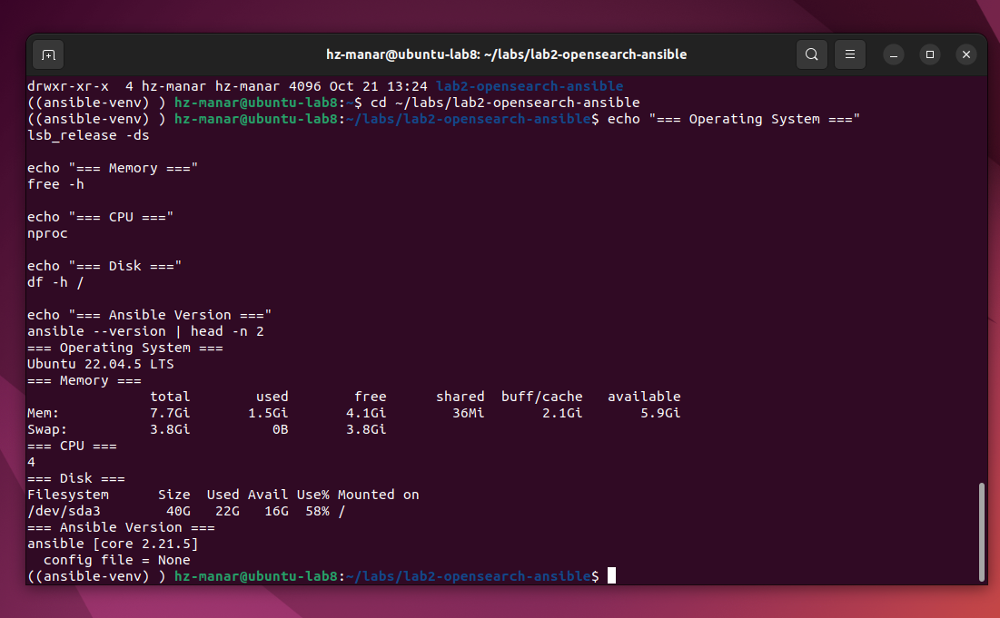

The VM started with a 40 GB disk that was already 58% full. OpenSearch stops allocating shards to a node at 85% disk usage (the low watermark), and three nodes share this disk with Prometheus and the logs, so I extended the disk to 80 GB before starting:

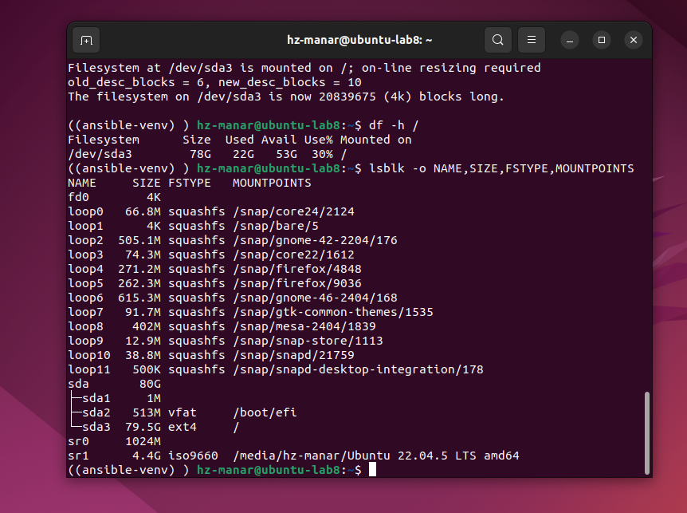

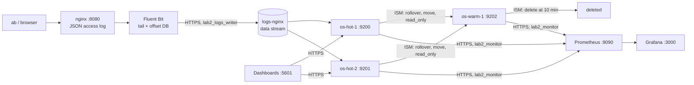

| Node | `node.attr.temp` | Roles | REST | Transport | Heap |
|---|---|---|---|---|---|
| os-hot-1 | hot | cluster_manager, data, ingest | 9200 | 9300 | 1 GB |
| os-hot-2 | hot | cluster_manager, data, ingest | 9201 | 9301 | 1 GB |
| os-warm-1 | warm | cluster_manager, data | 9202 | 9302 | 1 GB |

All three nodes are cluster-manager eligible, so the cluster has a real three-member voting configuration and keeps a quorum if one node process dies. They all run on one VM, though, so this shows the hot-warm mechanics and the coordination model, not tolerance to a host failure. All services listen on `127.0.0.1` only.

Project layout:

```text
lab2-opensearch-ansible/
├── README.md
├── screenshots/
└── ansible/
    ├── ansible.cfg
    ├── inventory.ini              # localhost, connection=local
    ├── requirements.yml           # pinned collections
    ├── lab2.yml                   # the single entry point
    ├── group_vars/all/
    │   └── vault.yml.example      # names of the 5 secrets; the real vault.yml is not committed
    └── roles/
        ├── opensearch_common/     # shared values: version, node list, user names, paths
        ├── opensearch/            # part 1: host, install, PKI, per-node config, systemd, checks
        ├── dashboards/            # part 1b
        ├── security/              # part 2
        ├── logging/               # part 3: nginx, ISM, template, Fluent Bit, checks, load
        └── monitoring/            # part 4: exporter settings, Prometheus, Grafana
```

Following the review of lab 1, `group_vars` holds only the secrets; every other value lives in a role's `defaults`. Values that several roles need (the node list, the data stream name, user names) are defined once in `opensearch_common/defaults/main.yml`, and the other roles pull them in through `meta/main.yml` dependencies instead of copying them. Nodes, roles, users and the access checks are lists of data, and the tasks loop over them. Timestamps come from Ansible's `now()`.

## 3. Running it

```bash
cd ansible
ansible-galaxy collection install -r requirements.yml -p ./collections

# secrets (once): five passwords, see the comments in the example file
cp group_vars/all/vault.yml.example group_vars/all/vault.yml
ansible-vault encrypt group_vars/all/vault.yml

ansible-playbook lab2.yml --syntax-check

# the whole lab: parts 1-4 plus the access matrix
ansible-playbook lab2.yml -K --ask-vault-pass
```

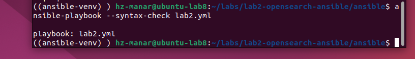

Each part, or a single step, can be run on its own:

| Tag | What it does |
|---|---|
| `part1` (`part1_prereq`, `part1_install`, `part1_certs`, `part1_config`, `part1_service`, `part1_verify`, `part1_dashboards`) | host, OpenSearch, PKI, nodes, Dashboards |
| `part2` (`part2_roles`, `part2_users`, `part2_verify`) | roles, users, mappings and their read-back |
| `part2_access` | the allowed/denied matrix; needs the data stream from part 3, so in a full run it runs last |
| `part3` (`part3_nginx`, `part3_ism`, `part3_template`, `part3_fluentbit`, `part3_verify`, `part3_status`) | log pipeline, template, ISM, end-to-end check, lifecycle snapshot |
| `part3_load` | traffic generator; tagged `never`, so it runs only when asked for by name |
| `part4` (`part4_plugin`, `part4_prometheus`, `part4_grafana`) | exporter settings, Prometheus, Grafana |

`part3_status` only reads the cluster. I ran it many times, about a minute apart, to watch the lifecycle.

## 4. Part 1: deployment and TLS

### 4.1 Three nodes on one host

The `opensearch` role prepares the host (packages, `vm.max_map_count=262144` for Lucene's memory-mapped files, a system user, directories). It then installs one OpenSearch archive and runs it three times:

- One systemd **template unit**, `opensearch@.service`, starts every node. `%i` is the node name and selects `OPENSEARCH_PATH_CONF=/etc/opensearch/<node>`, so each node has its own `opensearch.yml`, JVM options, certificates and security files, plus its own data and log directories under `/var/lib/opensearch/<node>` and `/var/log/opensearch/<node>`.
- The node list is data (`opensearch_nodes`), and `opensearch.yml.j2` is rendered once per node from it: name, roles, `node.attr.temp`, ports, `discovery.seed_hosts` and `cluster.initial_cluster_manager_nodes`.
- A node is restarted only when its configuration actually changed, and the restart is rolling: one node at a time, waiting until it has rejoined and the cluster is at least yellow before moving to the next.
- Before anything starts, the playbook asserts that the VM has at least 5.5 GB of RAM. Three 1 GB heaps plus Dashboards, Prometheus and Grafana do not fit in less.

The verification task reads `_cluster/health` and `_nodes`, and checks for every node that it is in the cluster, runs 3.8.0 and carries the expected `temp` attribute:

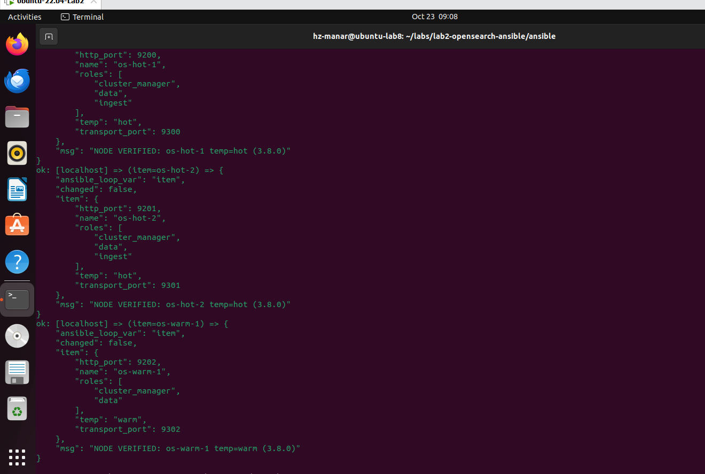

### 4.2 TLS

The playbook builds a small PKI with `community.crypto`: a root CA, one certificate per node, an admin client certificate and a certificate for Dashboards. Things that mattered here:

- **Keys are PKCS#8.** The security plugin does not accept the traditional RSA PEM format.
- **Hostname verification is on** (`enforce_hostname_verification: true`, `resolve_hostname: false`). Nodes connect to each other by IP, so every server certificate carries `IP:127.0.0.1` in its SAN, otherwise the transport handshake fails.
- **Node and admin identities are DNs.** `plugins.security.nodes_dn` accepts `CN=*.nodes.lab2.local,...`, and only `CN=lab2-admin,...` is a super admin. A certificate signed by the same CA with any other CN is not treated as a node.
- **The demo configuration is gone.** The archive ships demo users (`admin/admin`, `kibanaro`, `logstash`, ...). `internal_users.yml` is replaced with only `admin` and `kibanaserver`, hashed with the plugin's own `hash.sh`. bcrypt produces a new salt every time, so re-hashing on every run would rewrite the file and trigger restarts for nothing. The file therefore carries a `managed-by: lab2-ansible` marker and is written only once. With `allow_default_init_securityindex: true`, the security index is initialised on first start with no manual `securityadmin.sh` step.

The verification has three layers. A request goes over authenticated HTTPS, a plain-HTTP request to 9200 must fail, and `openssl s_client -verify_return_error` must verify the certificate chain on all six endpoints (three REST, three transport; the transport ones with the admin client certificate, because transport TLS is mutual):

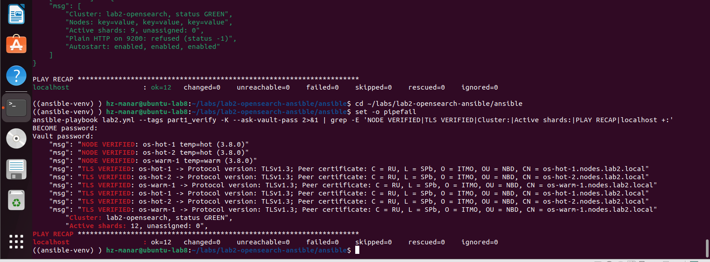

All six handshakes negotiated TLS 1.3, and each node presented its own certificate (`CN = os-hot-1.nodes.lab2.local`, and so on). The plain-HTTP request returned status `-1`: the node did not answer with HTTP at all, because the port speaks TLS only. The cluster was GREEN with 0 unassigned shards, and all three units were enabled for autostart.

### 4.3 OpenSearch Dashboards

Dashboards runs as its own systemd service on `https://127.0.0.1:5601`, with its own certificate. Towards OpenSearch it uses `verificationMode: full` against the lab CA and connects only to the two hot nodes. It logs in to OpenSearch as `kibanaserver`; people log in with their own users. The first start takes a few minutes, so the playbook polls `/api/status` for up to 40 × 10 s instead of failing early.

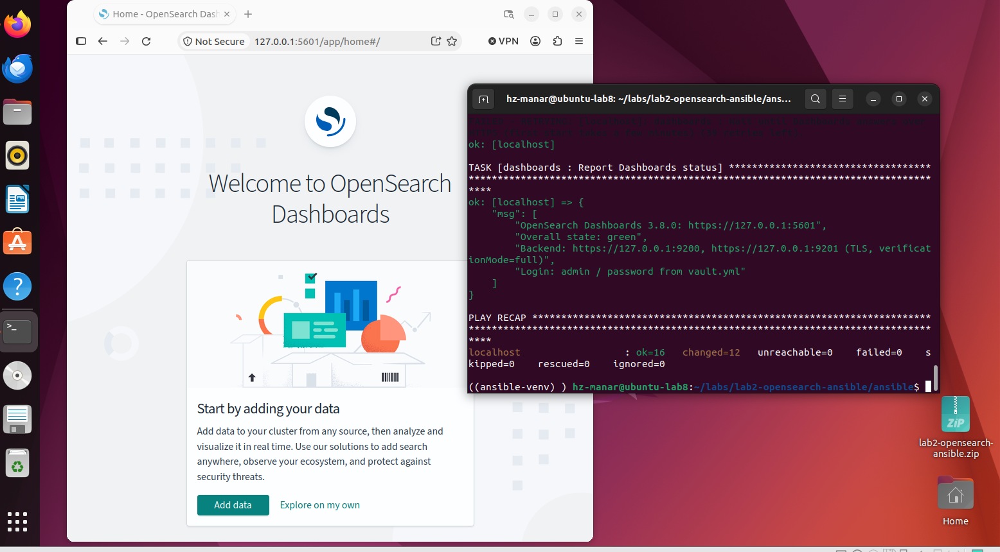

Firefox marks the page "Not Secure" in later screenshots. The connection is still HTTPS; the browser simply does not know the lab CA, because I did not import it into Firefox's trust store.

## 5. Part 2: role model

Roles and users are created through the Security REST API. Their definitions are data in `security/defaults/main.yml`:

| Role | Cluster permissions | Index permissions | Why |
|---|---|---|---|
| `lab2_logs_writer` | `indices:data/write/bulk` | on `logs-nginx`: `indices:data/write/index`, `indices:data/write/bulk*`, `indices:admin/mapping/put`, `indices:admin/mapping/auto_put` | `_bulk` is checked once as a cluster action and then per index. The mapping actions let dynamic fields be added. A permission on the data stream name also covers its backing indices `.ds-logs-nginx-*`. |
| `lab2_logs_reader` | `cluster_composite_ops_ro` | on `logs*`: `read`, `indices:admin/get` | Search, `msearch`, `mget` and scroll, which Dashboards' Discover needs. Nothing that writes, and no cluster health. |
| `lab2_monitoring` | `cluster:monitor/health`, `/state`, `/stats`, `/nodes/info`, `/nodes/stats`, `cluster:monitor/prometheus/metrics` | on `logs*`, `.ds-logs-nginx-*`: `indices:monitor/stats` | Exactly what the exporter calls: cluster and node statistics, plus index statistics for the log indices. No document access at all. |

One design decision made the writer role smaller: **the data stream is created by the admin in part 3, before Fluent Bit starts.** If the first write had to create it, the writer would also need the right to create data streams and indices. Because the stream already exists, the writer only appends to it.

Users are created only if they do not exist yet, so a second run does not reset passwords. `-e security_reset_passwords=true` forces it. Every user is mapped to exactly one role.

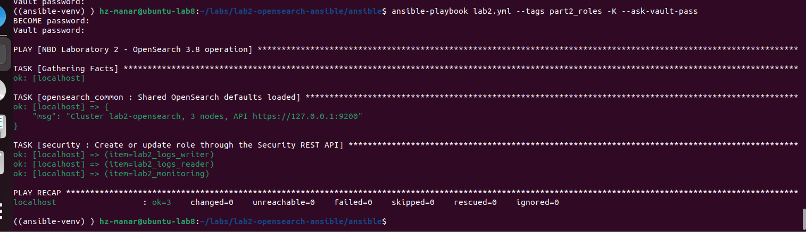

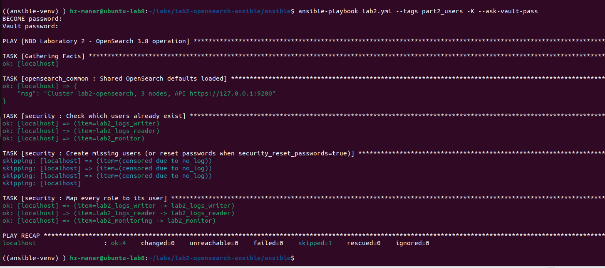

The read-back checks two things. First, the stored roles must contain exactly the defined permissions (compared as sorted lists). Second, every user logs in as themselves and calls `_plugins/_security/authinfo`, so the cluster reports the roles that user really gets:

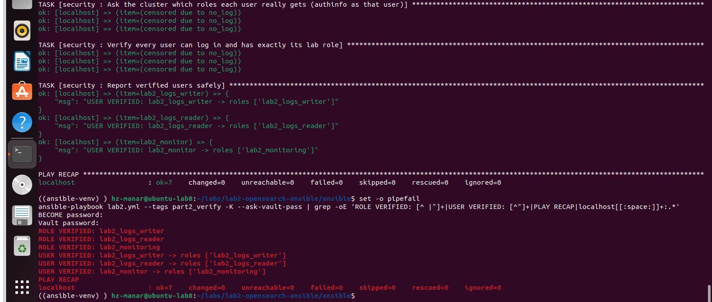

That a role exists, or that a user can log in, proves nothing about authorization. So `part2_access` sends real requests as each user and compares the HTTP status with the expected one:

| User | Operation | Expected | Got |
|---|---|---|---|
| lab2_logs_writer | write into `logs-nginx` | 201 | 201 |
| lab2_logs_writer | write into another index | 403 | 403 |
| lab2_logs_writer | search `logs-nginx` | 403 | 403 |
| lab2_logs_reader | search `logs*` | 200 | 200 |
| lab2_logs_reader | write into `logs-nginx` | 403 | 403 |
| lab2_logs_reader | cluster health | 403 | 403 |
| lab2_monitor | cluster health | 200 | 200 |
| lab2_monitor | node stats | 200 | 200 |
| lab2_monitor | `/_prometheus/metrics` | 200 | 200 |
| lab2_monitor | search `logs-nginx` | 403 | 403 |
| lab2_monitor | write into `logs-nginx` | 403 | 403 |

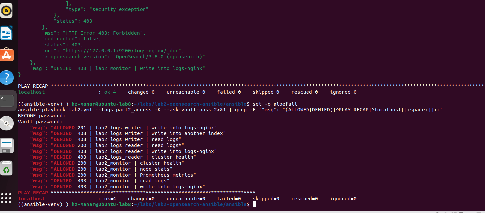

All 11 match. The denied cases matter as much as the allowed ones: a role with too many rights passes every "allowed" test.

## 6. Part 3: logs, template and ISM

The tasks run in this order on purpose: nginx, then the ISM policy, then the template and the data stream, then Fluent Bit. The policy has to exist before the first backing index is created, otherwise its `ism_template` cannot attach to that index. The data stream has to exist before Fluent Bit sends anything, for the permission reason above.

### 6.1 nginx writes JSON

A separate `log_format lab2_json escape=json` writes one JSON object per request to `/var/log/nginx/lab2_access.json`. `escape=json` matters: without it, a quote in a URI or user agent produces a broken line that the parser drops. `status`, `body_bytes_sent` and `request_time` are written without quotes, so they arrive as numbers. `@timestamp` and `time` are both `$time_iso8601`.

The check validates the config with `nginx -t`, requests the page, reads the last log line and asserts that it parses as JSON and has the expected `status`, `request_uri` and `time`:

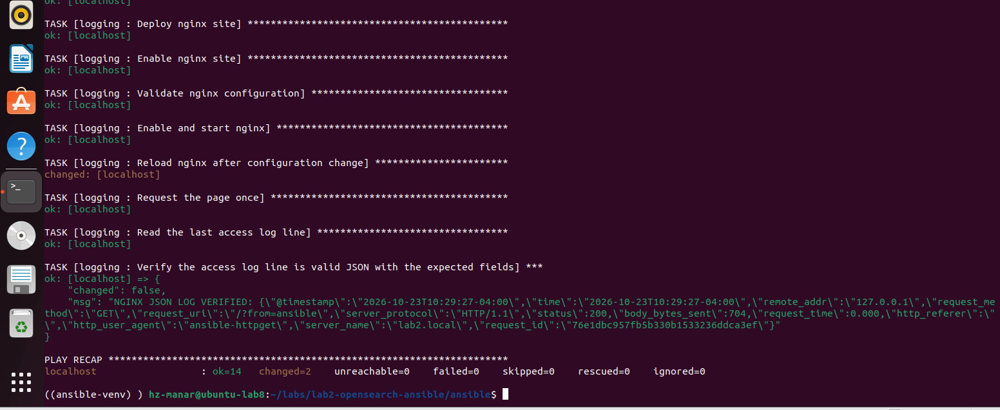

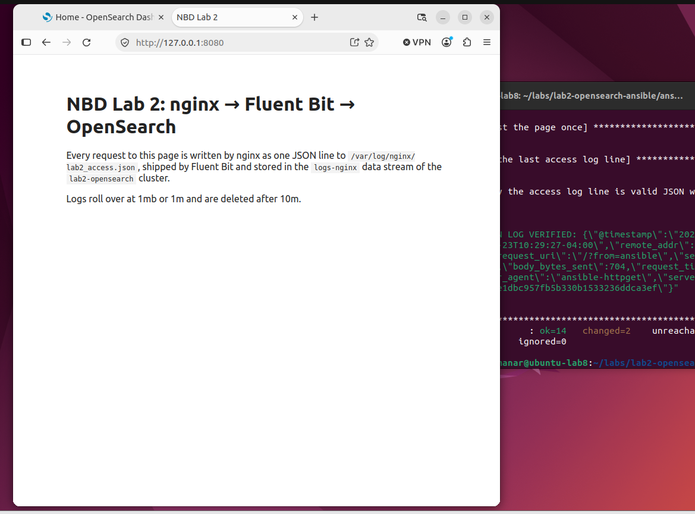

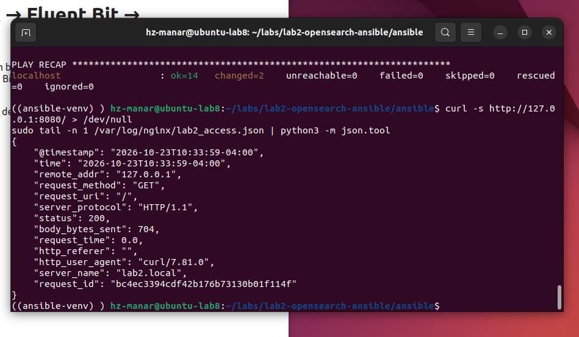

### 6.2 Fluent Bit

Fluent Bit tails the access log with an offset database (a restart does not resend old lines) and a filesystem buffer (lines survive a short outage of OpenSearch). It parses each line as JSON, adds `host` and `log_source`, and writes to `logs-nginx` with `Write_Operation create`, the only operation a data stream accepts.

It authenticates as `lab2_logs_writer`, not as admin, over TLS with CA verification. The password is not in `fluent-bit.conf`; it sits in `/etc/default/fluent-bit` (mode 0600) as an environment variable that the config references. Before every restart, the config is validated with `fluent-bit --dry-run`.

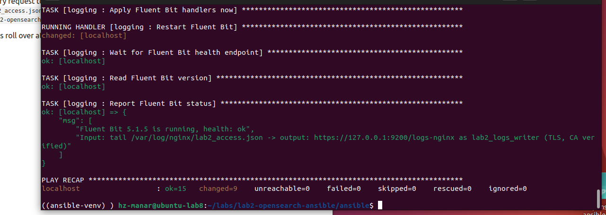

"The service is running" does not prove that logs arrive. So `part3_verify` sends three marked requests to nginx (two 200 and one 404) and polls OpenSearch until all three are searchable. It then checks that the newest one landed in a `.ds-logs-nginx-NNNNNN` backing index with a numeric status, a timestamp and the right host:

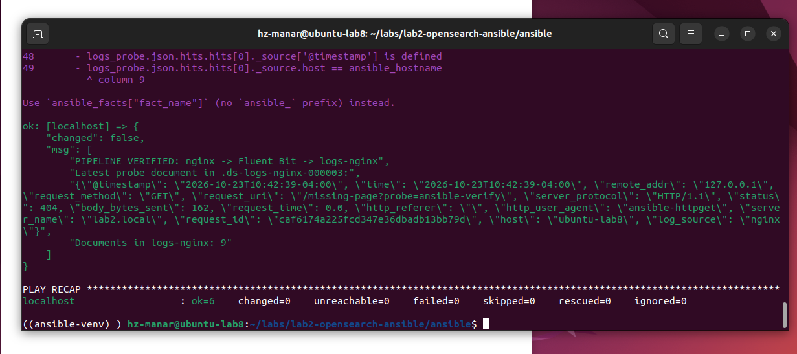

In the indexed document, `@timestamp` is nginx's own value, with its `-04:00` offset (`2026-10-23T10:42:39-04:00`). So the data stream is ordered by when the request happened, not by when Fluent Bit read the line.

### 6.3 Index template and data stream

`logs-nginx-template` is a composable template for `logs-nginx*` with a `data_stream` block and an explicit mapping:

| Field | Type | Reason |
|---|---|---|
| `@timestamp`, `time` | `date` | time-based queries and the data stream's timestamp field |
| `remote_addr` | `ip` | CIDR queries |
| `status` | `short` | range queries and aggregations by status |
| `body_bytes_sent`, `request_time` | `long`, `float` | sums, averages |
| `request_method`, `request_uri`, `server_name`, `request_id`, `host`, ... | `keyword` | exact match and aggregations, no analysis needed |
| `http_user_agent` | `text` + `keyword` subfield | full-text search and exact grouping |

Without a template, every string would become `text` plus a `keyword` subfield, which doubles the index work for fields like `request_id` that nobody searches by words. The settings give new backing indices 1 primary and 1 replica, `best_compression`, a 5 s refresh interval, and `index.routing.allocation.require.temp: hot`, so new indices land only on the hot nodes.

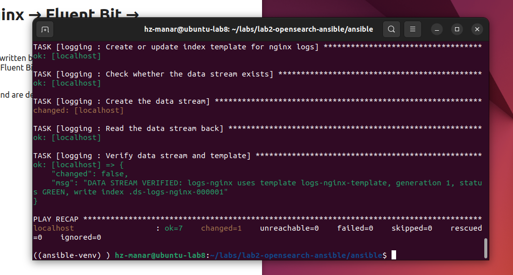

### 6.4 ISM policy

```text
hot:    rollover  min_size 1mb  OR  min_index_age 1m
          ↓
warm:   replica_count 0 → allocation require temp=warm (wait_for) → read_only
          ↓  when min_index_age ≥ 10m
delete: delete
```

ISM rollover conditions are OR-ed: the index rolls over as soon as one of them is true, which is exactly "1 MB or 1 minute, whichever comes first". In the warm state the index gives up its replica first, so only one copy has to move, then moves to `os-warm-1` and becomes read-only.

By default ISM checks managed indices only every **5 minutes**, which makes a 1-minute rollover impossible. The playbook therefore sets `plugins.index_state_management.job_interval` to 1 minute (the minimum, since the setting is in whole minutes) and the jitter to 0.

The policy is compared with the stored version before it is updated, and the update uses `if_seq_no` / `if_primary_term`, so it cannot silently overwrite a concurrent change. Afterwards the stored policy is read back and the thresholds are asserted:

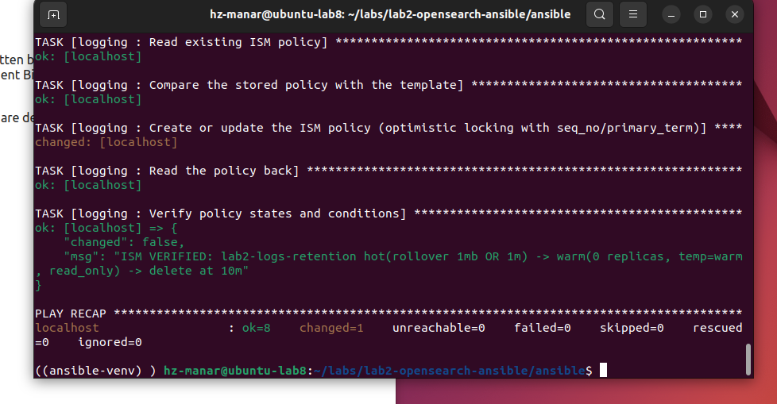

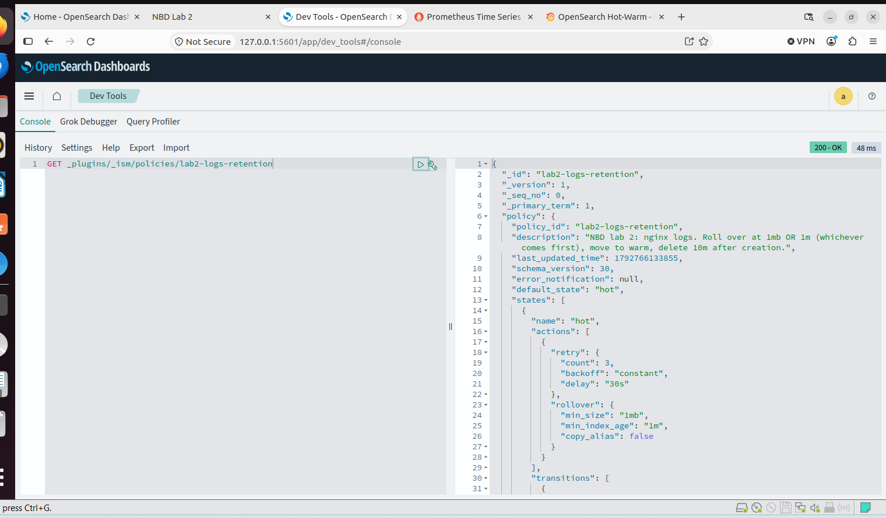

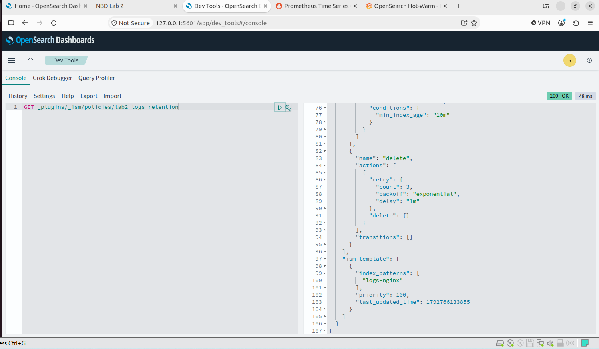

ISM Explain shows the policy actually executing. Index 000015 has rolled over (`rolled_over: true`) and is in `warm`, waiting in `attempt_transition_step` with `condition_not_met`, because it is not 10 minutes old yet:

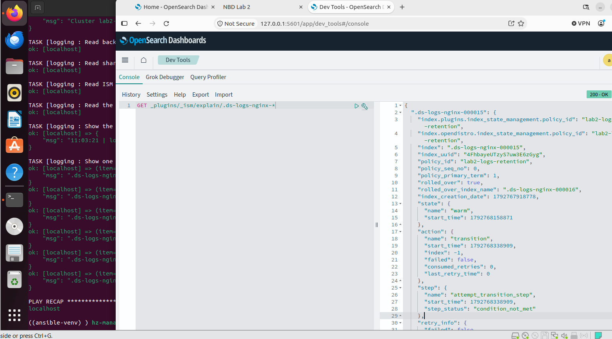

And a later write index, 000059, after `attempt_rollover` completed:

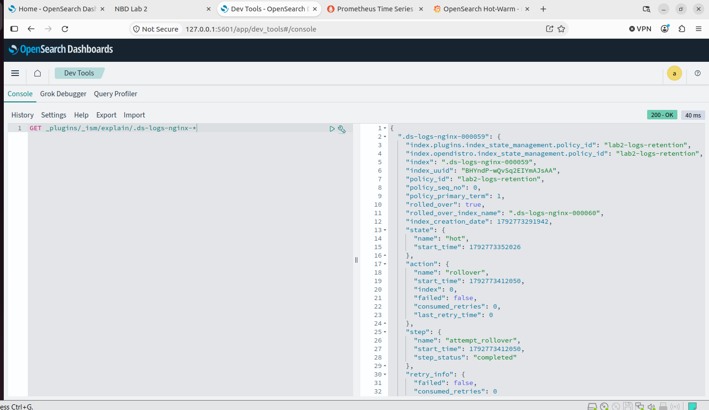

### 6.5 Does deletion really happen?

Showing the policy is not enough. I wanted to see indices disappear. `part3_status` prints the generation of the data stream and one line per existing backing index: creation time, documents, size, ISM state and action, and the nodes holding its shards.

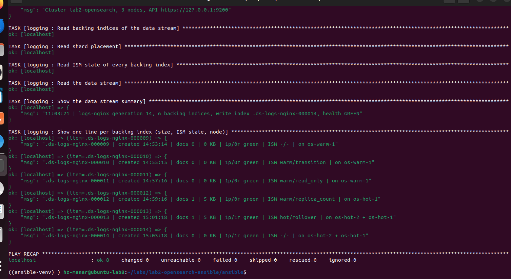

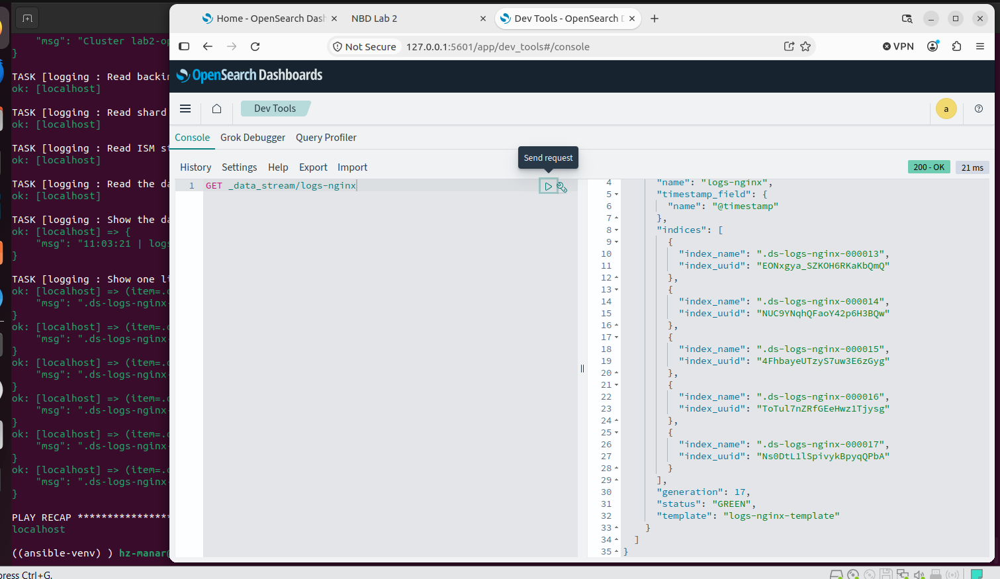

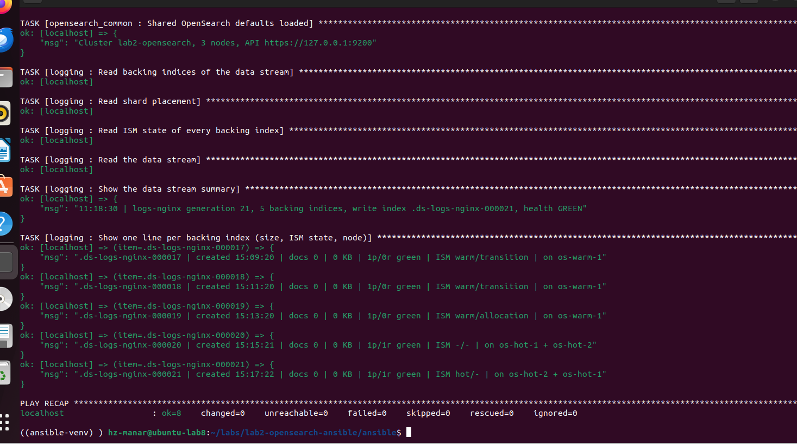

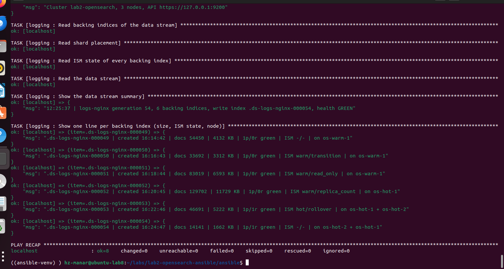

`_cat/indices` prints creation times in UTC, while the VM clock is EDT (UTC−4). After converting:

| Snapshot (VM time) | Generation | Backing indices that exist | Oldest existing index | Its age |
|---|---|---|---|---|
| 11:03:21 | 14 | 000009–000014 (6) | 000009, created 10:53:14 | 10 min 07 s |
| 11:18:30 | 21 | 000017–000021 (5) | 000017, created 11:09:20 | 9 min 10 s |
| 12:25:37 | 54 | 000049–000054 (6) | 000049, created 12:14:42 | 10 min 55 s |

At generation 54, the stream has created 54 backing indices, and only 6 exist. Indices 000001–000048 are gone, and no existing index is older than about 11 minutes. That is the retention policy working, repeatedly, over more than an hour. The upper bound I expect is 10 minutes plus up to two ISM runs (one to evaluate the transition, one to execute the delete), so about 12 minutes; the observed maximum was 10 min 55 s.

These snapshots also show three things I did not expect before running it:

1. **Rollover happens every ~2 minutes, not every minute.** Creation times are 10:53:14, 10:55:15, 10:57:16, 10:59:16, 11:01:18, 11:03:18. My reading: ISM first has to initialise a new index under the policy on one run, and the rollover condition (age ≥ 1 min) is evaluated on a later run. With a 1-minute job interval, the effective period becomes about two intervals. The condition "1 minute" is a minimum age at which rollover becomes allowed, not a timer.
2. **The 1 MB threshold can be exceeded by a lot.** During the load, 000052 grew to 11.5 MiB (11,729 KB) with 129,702 documents before it rolled over (screenshots 31, 32). ISM only looks at the index once a minute, and between two looks Fluent Bit wrote about a thousand documents per second into it. `min_size` is also a condition for eligibility, not a cap. On an idle stream the indices are tiny (0–5 KB), so there the age condition is what triggers.
3. **ISM does one action per run, and you can watch it.** In the generation-14 snapshot, neighbouring indices sit at different steps: 000013 is in `hot/rollover` on both hot nodes; 000012 is in `warm/replica_count` and has already dropped to `1p/0r` but is still on `os-hot-1`; 000011 has been moved to `os-warm-1` and is in `warm/read_only`; 000010 is waiting in `warm/transition`.

Retention works at index granularity, which is worth stating precisely. `min_index_age` counts from the moment the index was **created**, and each index receives writes for about two minutes. A document written at the end of that window is therefore deleted roughly 8 minutes after it arrived, one written at the start after about 10–11 minutes. If "every document is kept for at least 10 minutes" were a hard requirement, the delete transition should use `min_rollover_age: 10m` instead, which counts from the rollover. I kept `min_index_age`, because it matches the assignment's wording ("logs are kept for 10 minutes, after which they are deleted") and keeps the total amount of stored data bounded.

## 7. Part 4: monitoring

### 7.1 Exporter plugin

The OpenSearch Prometheus exporter is installed by the `opensearch` role **before the nodes start for the first time**. A plugin installed later is only loaded after every node has been restarted. Its version has to match OpenSearch exactly (3.8.0 → 3.8.0.0); `opensearch-plugin install` rejects any other version.

`part4_plugin` sets the exporter's dynamic settings:

- `prometheus.nodes.filter: _local`: every node reports only its own node metrics, and Prometheus scrapes all three nodes separately. One dead node then shows up as one target down, instead of disappearing from a single aggregated scrape.
- `prometheus.indices: true` with `selected_indices: .ds-logs-nginx-*`: per-index metrics only for the log backing indices. These are the indices the lab is about, and exporting every system index would multiply the number of time series for no benefit.

The task then scrapes every node **as `lab2_monitor`** and asserts that the response contains the cluster status, that node's own `node="..."` label and the JVM metrics:

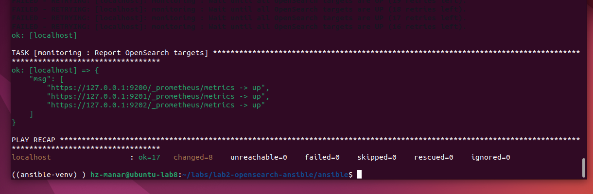

The first attempts in this screenshot are `FAILED - RETRYING`: right after a restart, Prometheus had not finished its first scrape yet. The task waits for all three targets to be `up` (up to 20 × 5 s) instead of reporting a false failure.

### 7.2 Prometheus and Grafana

Prometheus scrapes `/_prometheus/metrics` on 9200, 9201 and 9202 every 15 s, over HTTPS with the lab CA. It authenticates as `lab2_monitor` with a `password_file` (root-owned, readable only by the `prometheus` group), so the password is not in `prometheus.yml`. Every target gets `node_name` and `temp` labels. The config is checked with `promtool` before Prometheus is restarted.

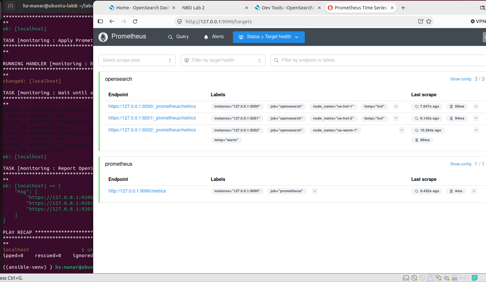

Grafana gets its data source (`Prometheus Lab 2`) and the dashboard through file provisioning, in its own folder "NBD Lab 2", separate from the lab 1 dashboard on the same Grafana. The playbook checks the provisioned JSON (uid, title, 25 panels) and asks Prometheus for `max(opensearch_cluster_status)`, so the value the dashboard shows is confirmed at the source.

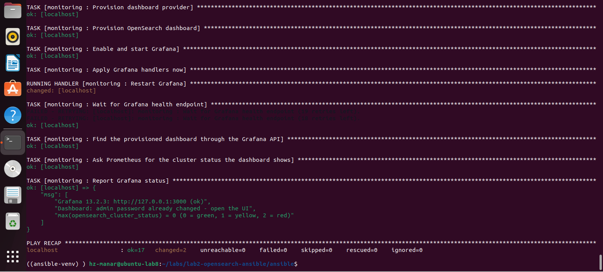

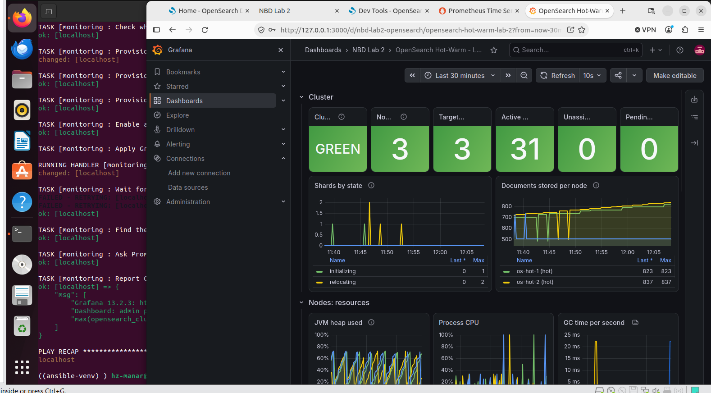

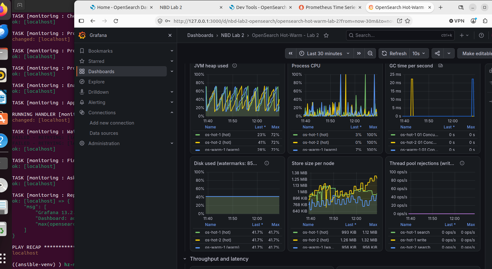

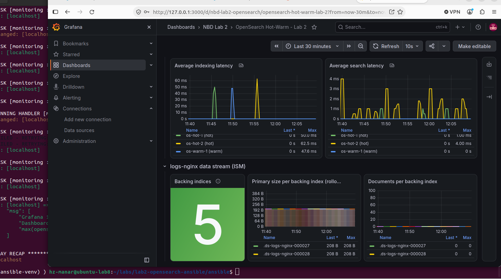

### 7.3 Which metrics and why

The dashboard has four rows. I chose each panel because it answers a question I would ask when something goes wrong, not because the metric exists.

| Row | Panels | The question it answers |
|---|---|---|
| Cluster | status, nodes, targets UP, active / unassigned shards, pending tasks | Is the cluster healthy and complete? Is monitoring itself still working? |
| | shards by state (initializing, relocating, unassigned) | Is the cluster busy moving data? In this lab every spike is a rollover or a move to warm. |
| | documents per node | Where does the data actually live? |
| Nodes: resources | JVM heap %, process CPU, GC time per second | Is a node short of memory? A heap that stays high, together with growing GC time, comes before rejections and timeouts. |
| | disk used, with the 85 / 90 / 95% watermarks in the title | How far is each node from OpenSearch refusing new shards (85%), moving shards away (90%) or making indices read-only (95%)? |
| | store size per node | Is ISM moving data from hot to warm and deleting it? |
| | thread pool rejections (write, search) | Is the cluster saturated? This is the first metric that turns into errors for clients. |
| Throughput and latency | indexing rate, search rate, average indexing / search latency | How much work arrives, and how expensive it is |
| logs-nginx data stream | number of backing indices, primary size and documents per backing index | Does the lifecycle do what the policy says: about 1 MB / 1 min per index, a bounded number of indices? |

Latency is an average (time spent divided by number of operations over 1 minute). It shows trends and spikes well, but it is not a p95 or p99; the exporter does not provide latency histograms.

## 8. Load test

The assignment does not ask for a load test in this lab. I added it because a dashboard on an idle cluster shows only flat lines, and because I wanted to see the 1 MB rollover condition trigger. `part3_load` (tag `never`, so it runs only when asked for) runs:

- `ab` with 30,000 requests to the page (HTTP 200), concurrency 20;
- `ab` with 3,000 requests to a missing page (HTTP 404, intentionally, so error responses appear in the logs);
- 100 searches as `lab2_logs_reader`, alternating status 200 / 404 with a per-minute date histogram.

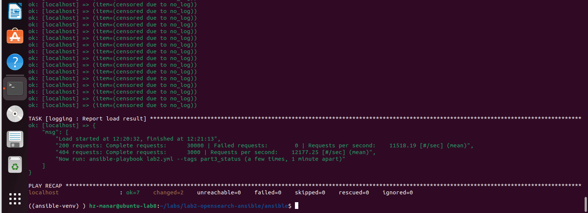

| Result | Value |
|---|---|
| Duration of the `ab` runs and searches | 12:20:32 – 12:21:13 |
| Page requests | 30,000 complete, 0 failed, 11,518 req/s |
| Missing-page requests | 3,000 complete (404 is the expected answer), 12,177 req/s |
| Searches as the reader | 100, all 200 |

These request rates are nginx's numbers, not OpenSearch's. The interesting part is what happened behind nginx:

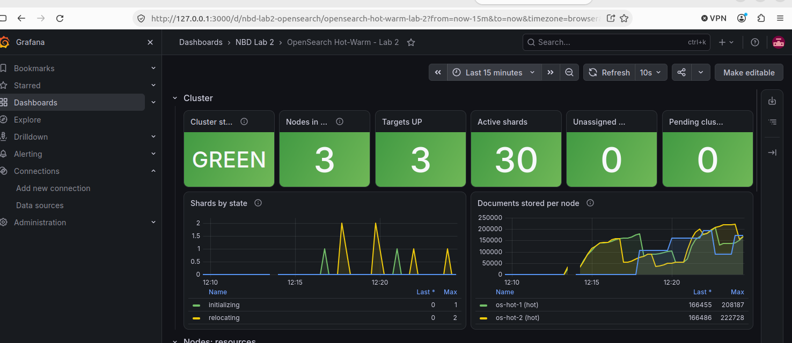

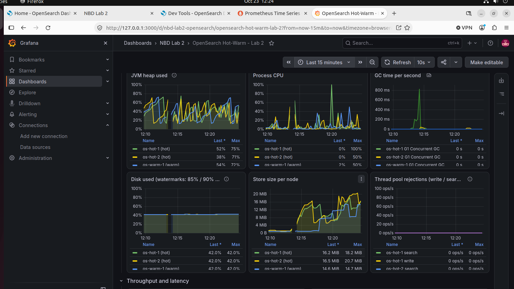

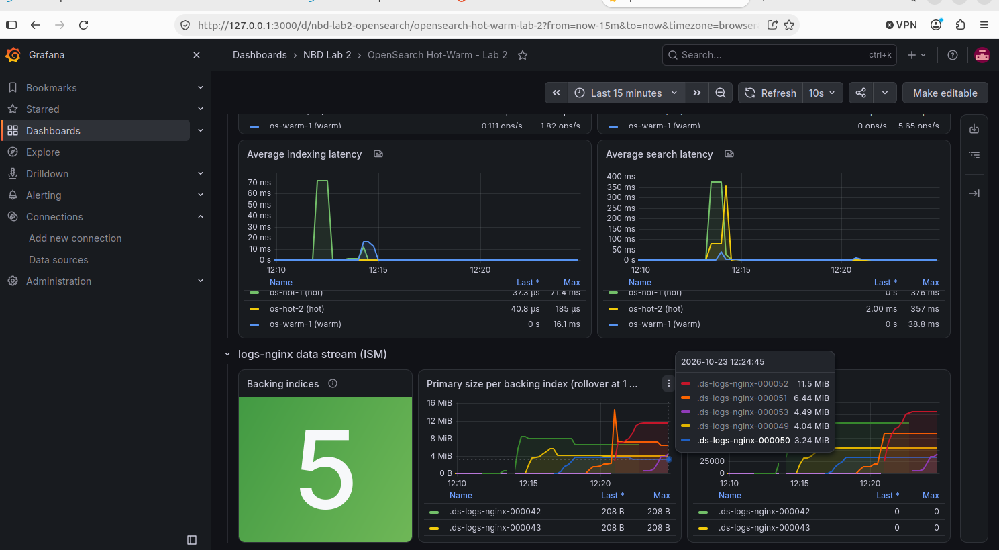

- **Indexing went on for minutes after the load had finished.** The load task ended at 12:21:13, but indices 000053 (created 12:22:46) and 000054 (12:24:47) still received 46,691 and 14,141 documents. nginx writes log lines much faster than one Fluent Bit output ships them into a replicated data stream on a shared VM, so Fluent Bit was draining a backlog from its buffer. Nothing was lost; it just arrived later. The document counts in 000049–000054 (about 360,000 in total) are larger than this one run, because they also contain the traffic from earlier runs in the same session, visible around 12:13 on the graphs.
- **No thread pool rejections** on write or search at any point. The cluster was never saturated; the limit was upstream, in the shipper.
- **The biggest spikes were on os-hot-1**: indexing latency up to 71 ms, search latency up to 376 ms, and a GC spike of about 800 ms per second, all at the same moment, during the earlier burst around 12:13. With a 1 GB heap, bulk indexing and aggregations compete for memory, and a GC pause shows up directly as latency. The second hot node reached 357 ms search latency at the same time, and the warm node stayed low, which is what you expect: it holds only read-only indices, and almost nobody queries them.
- **Heap** moved in the usual saw-tooth between roughly 20% and 75% on all nodes. **CPU** reached 100% on os-hot-1 for a short time during the load.
- **Shards by state** shows short spikes of 1–2 initializing or relocating shards every one to two minutes: the rollovers and the moves to the warm node. **Store size** grew on the hot nodes and then stepped onto the warm node as ISM moved indices.
- After the load the cluster was GREEN, 3 nodes, 0 unassigned shards, and the stream was at generation 54 with 6 backing indices.

## 9. What actually took time

Most of the time did not go into OpenSearch's features but into running three nodes on one machine, and into details that only show up when something fails:

- **ISM looked broken at first.** I configured a 1-minute rollover and nothing happened for minutes. The reason is the default `job_interval` of 5 minutes. Since then I check how often a scheduler actually runs before I trust a time-based condition.
- **The Security API rejected my first passwords.** Users created through the REST API must pass a minimum length (12 here) and the zxcvbn strength check. The error message does not say much, so the requirement is now written in `vault.yml.example`.
- **Three JVMs, one install directory.** The stock `jvm.options` writes the GC log, the error file and heap dumps relative to the install directory, which all three nodes share. They would write into the same `logs/gc.log`. The playbook rewrites these paths per node. For the same reason I removed the Performance Analyzer plugin: it writes to shared paths under `/dev/shm`, and I did not use it.
- **Plugin order.** The exporter must be installed before the first start, and it must have exactly the cluster's version. Installing it afterwards means restarting every node.
- **Certificates.** PKCS#8 keys, and an IP SAN because hostname verification is on and nodes talk to each other by IP. Both errors appear only as failed handshakes in the node logs.
- **Permissions for data streams.** Letting the writer create the data stream on its first write would work, but it needs creation rights that a log shipper should not have. Creating the stream as admin up front keeps the writer role small, and it means the order of the part 3 tasks matters.
- **Reading ISM output.** An index that sits in `warm/transition` for minutes is not stuck; it is waiting for its age. And `_cat` prints creation times in UTC while the VM runs on EDT, so every age in [6.5](#65-does-deletion-really-happen) had to be converted before it made sense.

What I take from this lab: a policy that has been stored is not the same as a policy that runs. The useful evidence was not the `ISM VERIFIED` line but watching generations go up while the oldest index never got much older than 10 minutes.

## 10. Limitations and what I would change

- **One host.** Three nodes on one VM share CPU, memory, disk and fate. For real hot-warm I would put the nodes on separate machines, with real fast and slow disks behind the `temp` attribute.
- **One ingest endpoint.** Fluent Bit sends to `os-hot-1:9200` only. If that node is down, logs wait in Fluent Bit's buffer until it returns. With separate hosts I would list both hot nodes, or put a load balancer in front of them.
- **Retention is per index.** See [6.5](#65-does-deletion-really-happen): a document lives about 8–11 minutes. `min_rollover_age` would give "at least 10 minutes" per document.
- **No replica on warm.** Dropping the replica in the warm state saves space and makes the move cheaper, but losing `os-warm-1` would lose the warm data. For logs that must survive a node failure, I would keep one replica on a second warm node.
- **Averages, not percentiles.** The dashboard shows average latency; tail latency would need client-side measurements or a proxy that records histograms.
- **No alerting.** The dashboard shows problems, but nobody is notified. The natural next step is Prometheus alert rules for cluster status ≠ green, a target down, disk above 80%, and thread pool rejections > 0.

