# Lab 3 — Redis Cache-Aside for a Library Catalogue

## The problem I chose

For this lab, I chose to cache data from a primary database. I built a library catalogue API where a book response includes author information, a review count and an average rating. The service also returns the highest-rated books in a genre. These reads involve joins and aggregation, so repeatedly calculating the same response creates avoidable work for PostgreSQL.

My aim was to measure whether Redis could reduce that work while keeping updates visible and allowing the API to continue serving reads if the cache became unavailable. PostgreSQL remains the source of truth. Redis stores temporary results that the application can rebuild.

I used three practical requirements to guide the experiment: repeated reads should reuse cached results, writes should invalidate affected entries, and a Redis outage should not immediately make catalogue reads unavailable. I also needed enough visibility to distinguish a fast cache hit from a slow database read, a cache error or an overloaded database connection pool. For the mixed workload, I set a cached-response p95 target below 100 ms, an HTTP failure rate below 1% in both scenarios, no dropped iterations and a 100% check success rate. These are the acceptance criteria in my test script, rather than a claim that the service meets them under every load.

## Environment and architecture

I ran the experiment in an Ubuntu 22.04.5 LTS virtual machine on VMware, with four logical CPUs and approximately 11 GiB of RAM available to Ubuntu. The environment screenshots show Docker 29.9.2 and Docker Compose v5.6.1. All application, database, monitoring and load-generator containers share this VM, so the results describe this local setup.

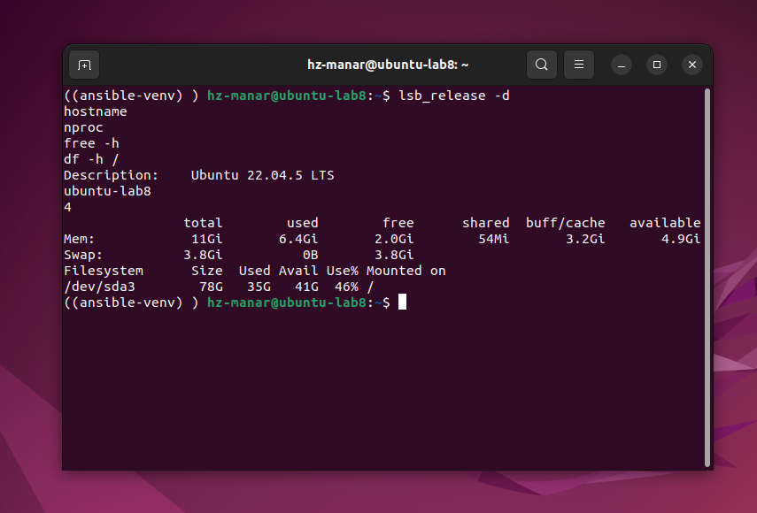

*My Ubuntu VM and its CPU, memory and disk resources.*

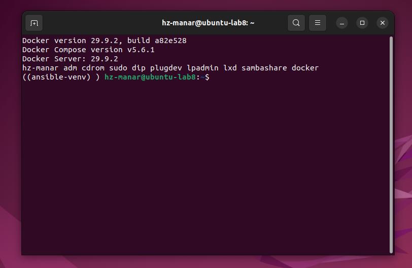

*Docker and Compose versions in my test environment.*

I used FastAPI for the HTTP service, PostgreSQL for persistent data, Redis for caching, k6 for traffic generation, and Prometheus with Grafana for monitoring. The initial dataset contains 5,000 authors, 100,000 books and 2,000,000 reviews. Reviews are distributed unevenly across books, making some aggregate reads more expensive than others. Load tests also insert reviews and update prices, so the database evolves after initialization.

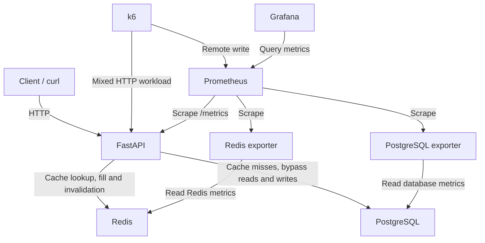

The diagram separates application traffic from monitoring traffic. The exporters observe the databases; they do not sit in the request path. k6 sends requests to the API and exports its own measurements to Prometheus, which lets me compare client-side results with application and database activity.

## How the service uses Redis

I used cache-aside: the application first looks for a response in Redis, reads PostgreSQL on a miss, and stores the result with an expiry time. A `cache=false` query parameter bypasses the cache for comparison. The `X-Cache` response header makes the path visible through values such as `MISS`, `HIT`, `WAIT_HIT`, `NEGATIVE_HIT` and `BYPASS`.

Book responses and the genre list have a base TTL of 3,600 seconds, while genre rankings have a base TTL of 60 seconds. Positive entries receive up to 10% TTL jitter to spread expirations. Missing books use a separate 30-second negative-cache marker. For genre rankings, the application can refresh an entry in the background when less than 20% of its base TTL remains. It caches up to 50 ranked books per genre and returns the requested slice, avoiding a separate cache entry for every limit.

Price updates are written to PostgreSQL before the book entry is invalidated. Adding a review invalidates both the book entry and the relevant genre ranking because the review changes their aggregate information. Prices must be greater than zero, below 100,000 and have no more than two decimal places. The application uses `Decimal` for price validation and database writes.

To limit duplicate work on a missing key, the loader acquires a Redis lock with a unique ownership token. The lock has a three-second lease that is renewed while the load is running. Lua scripts check ownership before storing a result or releasing the lock. Invalidation removes the cached value and its lock together, preventing an older loader that lost ownership from refilling that entry. Waiting requests can reuse the loaded value, but their wait is bounded: after the wait limit, they may fall back to their own database read.

Each API process starts with a fresh cache namespace. If invalidation fails because Redis is unavailable, the process switches namespace so subsequent requests do not reuse potentially stale entries from the previous namespace. Redis errors also trigger database fallback, with a short circuit-breaker cooldown after repeated failures. This design is intended for the single API process used in this deployment.

I limited Redis to 256 MiB with the `allkeys-lfu` eviction policy. This lets Redis evict less frequently used keys if the cache reaches its limit. AOF is disabled and periodic RDB snapshots are configured; persistent catalogue data remains in PostgreSQL. Separate Redis users serve administration, the application and monitoring. My ACL check showed that the application user could not run `FLUSHALL`, while an unauthenticated request was rejected.

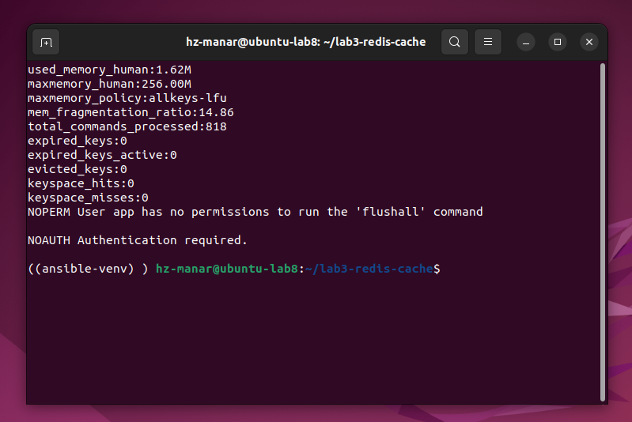

*Redis memory configuration and access-control checks: FLUSHALL denied for the application user and authentication required.*

## Running the project

I ran the following commands from the project directory inside Ubuntu. The host needs Docker with Compose, Bash, Make, OpenSSL, curl and Python 3; application dependencies are installed in the API image.

```bash
chmod +x postgres/init/03-roles.sh redis/start-redis.sh scripts/*.sh
make env
mkdir -p load/results
docker compose up -d --build --wait --wait-timeout 600
docker compose ps
curl -sS http://127.0.0.1:8000/health
```

`make env` creates a local `.env` with generated passwords when the file does not already exist. I keep that file out of Git. PostgreSQL creates and seeds the database when its data volume is first initialized. On a fresh deployment, this takes longer than restarting existing containers.

Inside the VM, the interactive API documentation is available at `http://127.0.0.1:8000/docs`, Grafana at `http://127.0.0.1:3001`, and Prometheus at `http://127.0.0.1:9091`. Grafana uses the username `admin` and the `GRAFANA_ADMIN_PASSWORD` value from `.env`. The provisioned dashboard is under **NBD Lab 3 → Redis cache-aside - Lab 3**. Published ports are bound to the VM's loopback interface.

The API exposes book reads, genre listings and genre rankings, plus price updates and review creation. `/health` reports database and cache availability, and `/metrics` supplies application metrics. I used `docker compose down` to stop the stack while keeping its named volumes. Removing volumes would also remove the stored database and monitoring history.

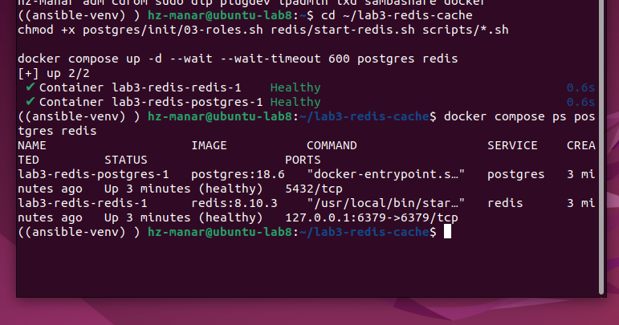

*PostgreSQL and Redis running with healthy container status.*

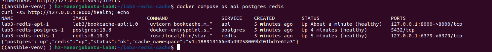

*API, PostgreSQL and Redis running as healthy containers, with a successful health response.*

## Functional checks and concurrent requests

I first ran the functional and concurrency checks:

```bash
make smoke
N=50 make stampede
```

In the smoke test, the first read of book 42 returned `MISS` in 15.7 ms, and the second returned `HIT` in 2.1 ms. The genre ranking took 272.4 ms on a miss and 3.4 ms on a hit. These individual measurements show the difference between calculating a response and reusing it; I do not treat them as average performance for the whole service. Database and operating-system caches can also make later database reads much faster than the first read.

The same test confirmed that a price update removed the book's cached copy. The next read returned the new price with `MISS`, followed by a `HIT`. A nonexistent book returned HTTP 404 first with `MISS` and then with `NEGATIVE_HIT`, showing that negative caching preserved the response semantics. The direct-read comparison returned `BYPASS`. All smoke checks passed.

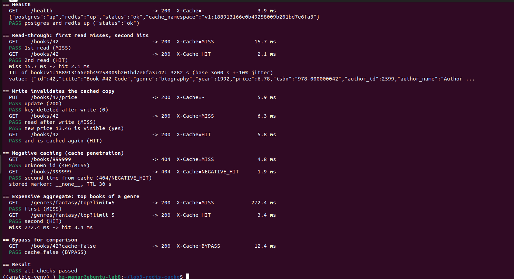

*Smoke checks covering cache hits, invalidation, negative caching, genre rankings and bypass reads.*

The stampede test made the effect on database work more visible. With 50 simultaneous requests for one missing ranking entry, I observed one `MISS` and 49 `WAIT_HIT` responses. All 50 requests returned HTTP 200, the burst completed in 919 ms, and the application recorded one database loader attempt.

With the cache bypassed, the same burst took 4,360 ms. There were 27 HTTP 200 responses and 23 HTTP 503 `OVERLOAD` responses. The bounded PostgreSQL pool could not admit all requests within its limits. The reported 50 loader attempts include pool rejections, so they must not be interpreted as 50 successfully executed SQL queries. This comparison shows how sharing one loaded result can protect the database during a burst, beyond simply making an individual request faster.

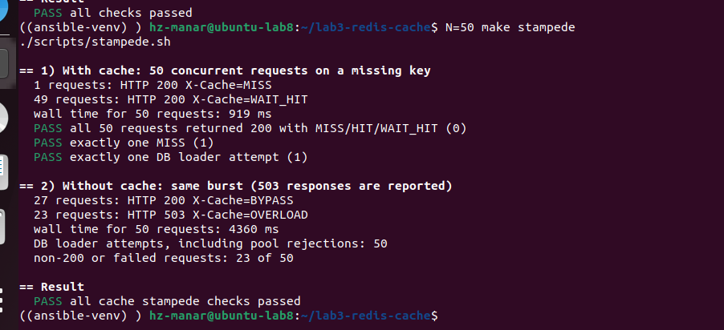

*The 50-request burst: one loader with caching, compared with overload responses when bypassing it.*

## Load testing and what the results mean

I started with a small warm-cache check to isolate the hit path:

```bash
docker compose --profile load run --rm \
  k6 run -o experimental-prometheus-rw /scripts/warm-cache-test.js
```

This test targets one previously warmed book at one iteration per second for 20 seconds. The recorded run completed 21 scenario iterations, with all 42 checks passing. The scenario p95 was 4.95 ms and the failure rate was zero. The overall p95 of 5.11 ms also includes the setup request. This confirmed that the hit path was fast, but it did not establish the performance of a changing catalogue under mixed traffic.

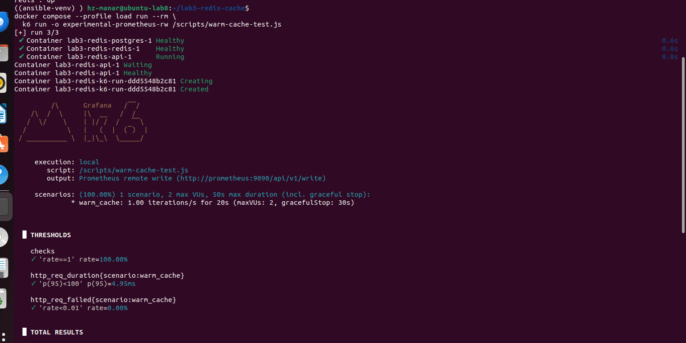

*Warm-cache test configuration and passing thresholds.*

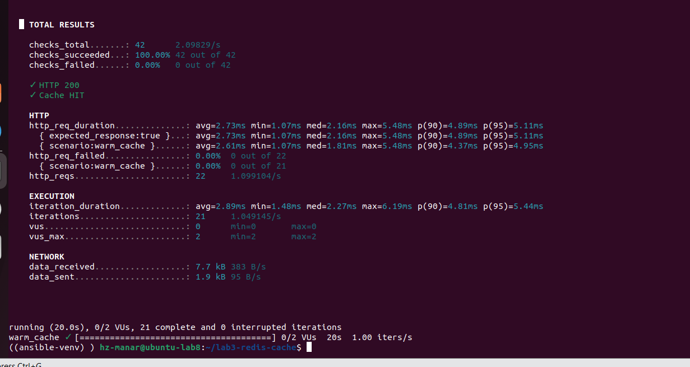

*Warm-cache measurements: all HTTP-status and cache-hit checks passed.*

For the broader comparison, I used:

```bash
make load RATE=20 DURATION=1m
```

The script runs a cached scenario followed by a bypass scenario. Each has a five-second ramp and a one-minute target period, with the second scenario scheduled five seconds after the first scenario's traffic stages end. Each iteration makes one HTTP request. The configured workload is 74% existing-book reads, 1% missing-book reads, 18% genre-ranking reads, 2% genre-list reads, 3.5% review creation and 1.5% price updates. Expected HTTP 404 responses for missing books are checked as valid outcomes.

Before measurement, the setup warms 64 books, all 12 genre rankings and the genre list. The measured workload can select from the full 100,000-book catalogue, with a preference for lower IDs. Consequently, this is a mixture of hits, misses and invalidations, not an all-hit benchmark. The two scenarios use the same traffic distribution but independently sampled requests; they do not replay an identical request sequence.

I initially tried a lighter three-request-per-second comparison, then used 20 requests per second for the main result.

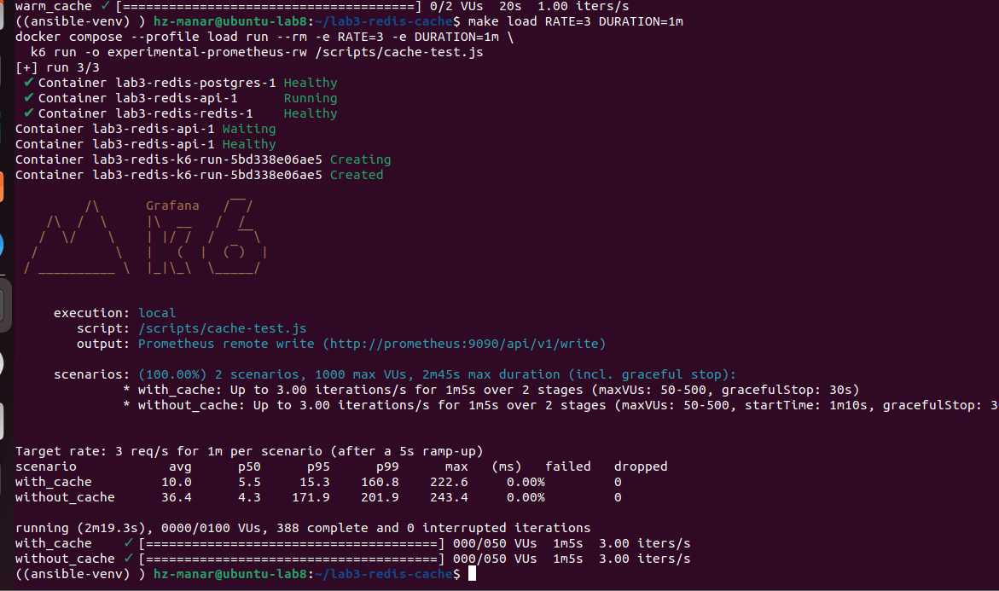

*Earlier exploratory comparison at 3 requests per second; this is separate from the main 20-request-per-second result.*

My recorded successful 20-request-per-second run completed 2,549 iterations with exit code 0 and passed all configured thresholds.

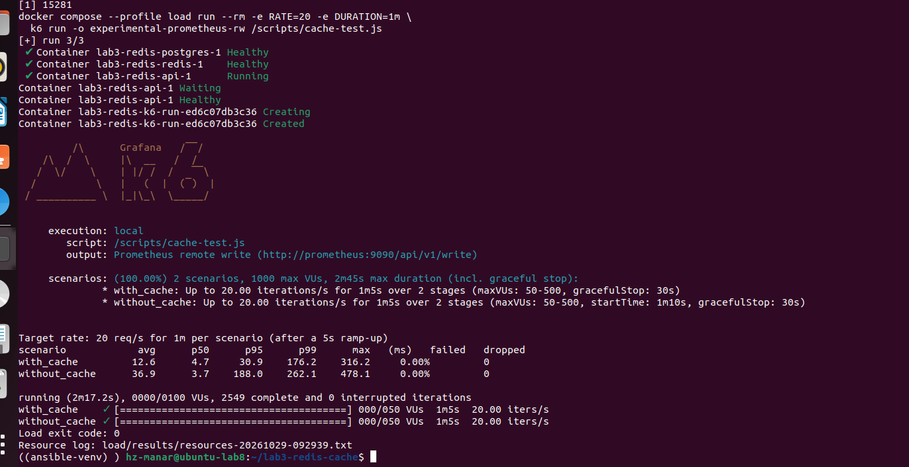

*The successful 20-request-per-second run, including exit code 0 and the resource-log location.*

| Scenario | Average | p50 | p95 | p99 | Maximum | HTTP failures | Dropped iterations |
|---|---:|---:|---:|---:|---:|---:|---:|
| With cache | 12.6 ms | 4.7 ms | 30.9 ms | 176.2 ms | 316.2 ms | 0.00% | 0 |
| Without cache | 36.9 ms | 3.7 ms | 188.0 ms | 262.1 ms | 478.1 ms | 0.00% | 0 |

The average response time was about 2.9 times lower with the cache, and p95 was about 6.1 times lower. The p95 result is particularly useful here: it shows that the slower portion of the workload benefited substantially from reusing aggregate results. However, the median was slightly lower without Redis, at 3.7 ms compared with 4.7 ms. Cheap database reads can already be fast, while caching adds lookup and serialization work. I therefore interpret the benefit as a reduction in average and tail latency for this workload, rather than an improvement to every request.

The cached p99 was still 176.2 ms, even though its p95 was below 100 ms. That is consistent with a mixed workload containing misses and writes; the p95 threshold does not require every response to finish within 100 ms.

I also retained an unsuccessful run at the same nominal rate. Its cached p95 was 169.0 ms. Without the cache, p95 reached 7,129.4 ms, the HTTP failure rate was 7.60%, and k6 dropped 157 iterations. Dropped iterations represent scheduled work that k6 did not start, whereas HTTP failures describe requests that were sent. Both matter when judging whether the target load was sustained.

I kept both runs because a later pass does not erase an earlier failure. I checked memory, CPU activity and container logs, and recorded resource activity during the repeat. Those observations do not establish a single cause for the earlier slowdown. All components share a VM, database state changes during testing, and the cached scenario runs first, potentially warming database and operating-system caches for the bypass scenario. The successful run supports the measured comparison under those conditions; it is not a capacity guarantee.

The exact summaries are saved in [the successful run](docs/results/load-20rps-passed.txt) and [the unsuccessful run](docs/results/load-20rps-failed.txt). Their [successful JSON](docs/results/load-20rps-passed.json) and [unsuccessful JSON](docs/results/load-20rps-failed.json) retain the full k6 metrics and threshold outcomes. The repeat's resource record is in [resources-20rps.txt](docs/results/resources-20rps.txt).

## Monitoring and dashboard interpretation

I configured Prometheus to scrape the API, Redis exporter, PostgreSQL exporter and Prometheus itself every five seconds. My target check showed all four jobs up.

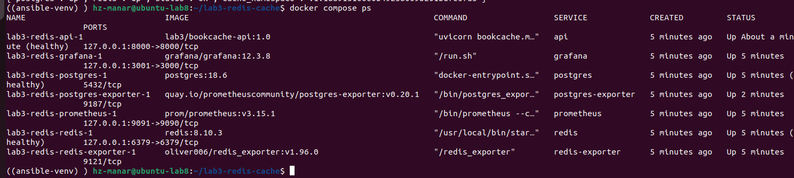

*The monitoring stack running alongside the API and databases.*

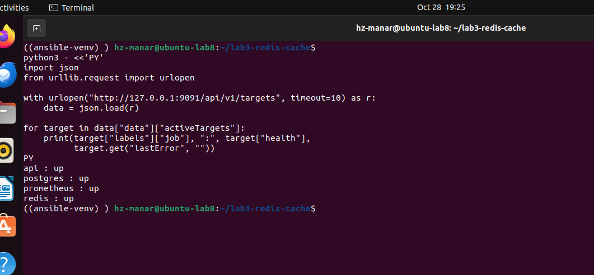

*Prometheus reports all four configured scrape targets as up.*

The application exports HTTP latency and request counts, cache outcomes, invalidations, refresh activity, cache errors and database-pool metrics. The dashboard combines these with Redis memory, commands, hits and misses, expired and evicted keys, connections and command latency, as well as PostgreSQL transactions, fetched rows and connection states.

The saved Grafana views cover both the unsuccessful and successful 20-request-per-second runs. The earlier high-latency peaks therefore belong to a different attempt from the final passing summary. I use the saved k6 summaries for whole-run comparisons and the graphs to understand when traffic, latency and database activity changed.

The overview displayed an application cache hit ratio of 28.4% and a Redis keyspace hit ratio of 55.8%. These are different measurements. The application counts cache outcomes, while Redis counts key lookups, including lookups involved in locking and coordination. I do not expect the ratios to match. Warming only a small part of the catalogue, reading many distinct books and invalidating entries through writes also limits the application hit ratio. A red dashboard threshold is a reason to inspect the workload, not by itself proof that caching is broken.

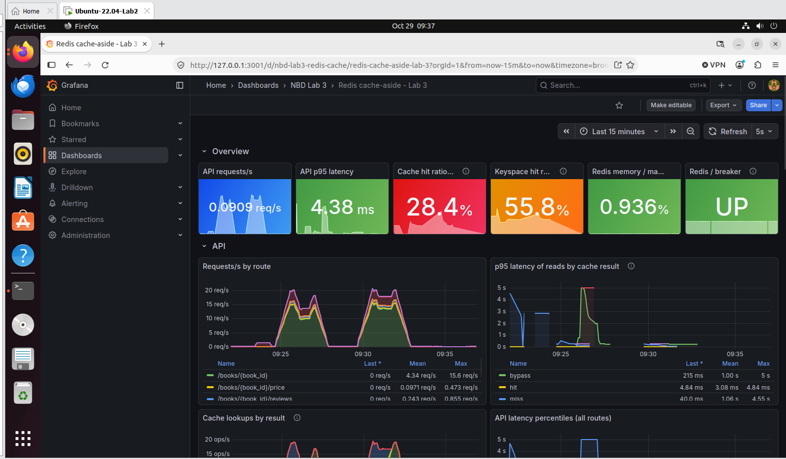

*Overview of API traffic, latency, cache ratios and Redis status across the selected time window.*

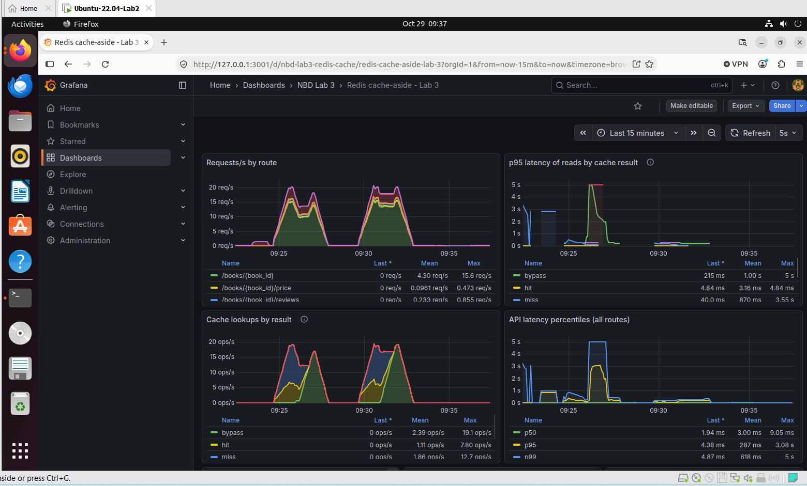

*API request rates, cache outcomes and latency distributions across both recorded load attempts.*

Redis used roughly 2.4 MiB against its 256 MiB limit in the saved view, and the eviction rate remained zero. Expiration activity was visible, which is expected for TTL-based entries. This run did not exercise memory pressure or prove eviction behavior under a full cache. The high memory-fragmentation ratio also needs context: at such a small dataset size, process and allocator overhead can make the ratio large. I would assess absolute memory usage and its trend before treating that ratio alone as evidence of a leak.

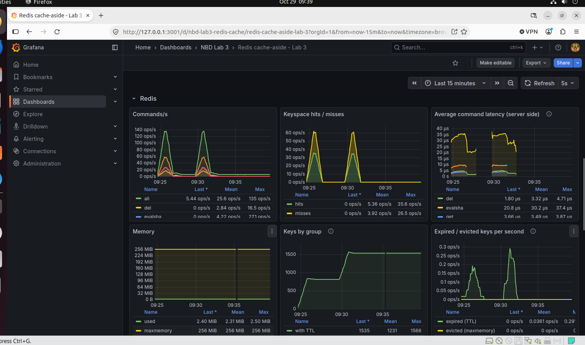

*Redis commands, hits and misses, command latency, memory, keys and expiration activity.*

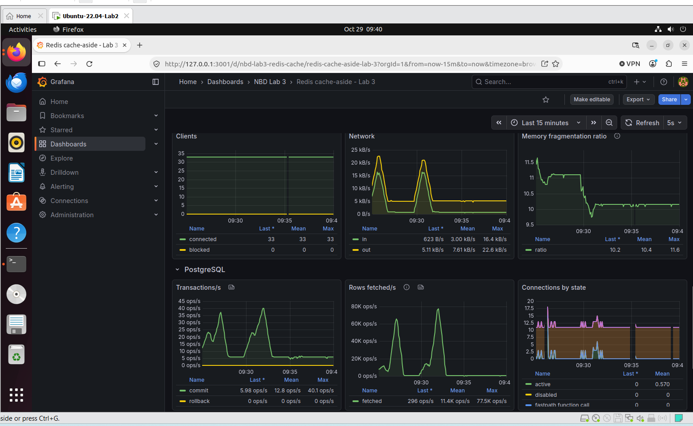

*Redis connections and memory fragmentation, followed by PostgreSQL transactions, fetched rows and connection states.*

The k6 latency panel is explicitly labelled **max request-group p95 / p99**. It shows the maximum among exported request-group percentiles, rather than calculating a single percentile over every request in the scenario. This is why I do not substitute its values for the aggregate p95 in the terminal summary. Redis server-side command latency, measured in microseconds, is another distinct measure: it excludes the full HTTP request path and any PostgreSQL work.

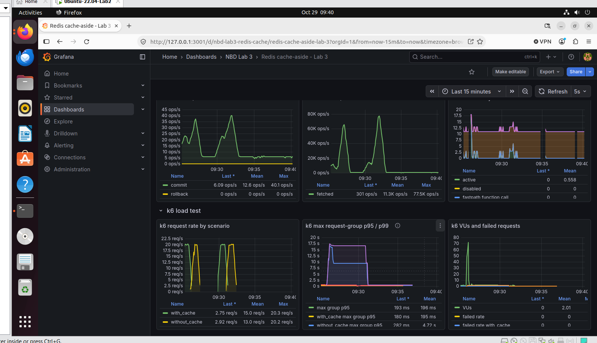

*k6 request rates and maximum request-group percentiles. The window includes the earlier unsuccessful attempt and the later successful attempt.*

Prometheus alert rules cover Redis availability, circuit-breaker activity, cache hit ratio, memory pressure, evictions, API latency and database-pool waiting. Their duration conditions mean that a short experiment does not necessarily make an alert fire. Dashboard screenshots are collected in [docs/screenshots](docs/screenshots/), and the dashboard definition is versioned in [redis-cache.json](monitoring/grafana/dashboards/redis-cache.json).

## Redis outage and input validation

I tested read availability during a deliberate Redis outage using:

```bash
make chaos
```

The script stops Redis, checks five book reads and the health endpoint, waits 30 seconds, then starts Redis and checks recovery. All five book requests returned HTTP 200 while Redis was stopped. Their `X-Cache: ERROR` headers indicated database fallback, and response times were about 510–530 ms, with the first request taking about 1 s. `/health` reported PostgreSQL up, Redis down and the service degraded. This distinguishes reduced functionality from complete service failure.

After Redis restarted, the recovery sequence moved through `ERROR`, `MISS` and then `HIT`. All chaos checks passed. The experiment demonstrates that these reads remained available during a cache outage and that cache use recovered. It does not demonstrate database failover or availability under simultaneous Redis failure and heavy database load.

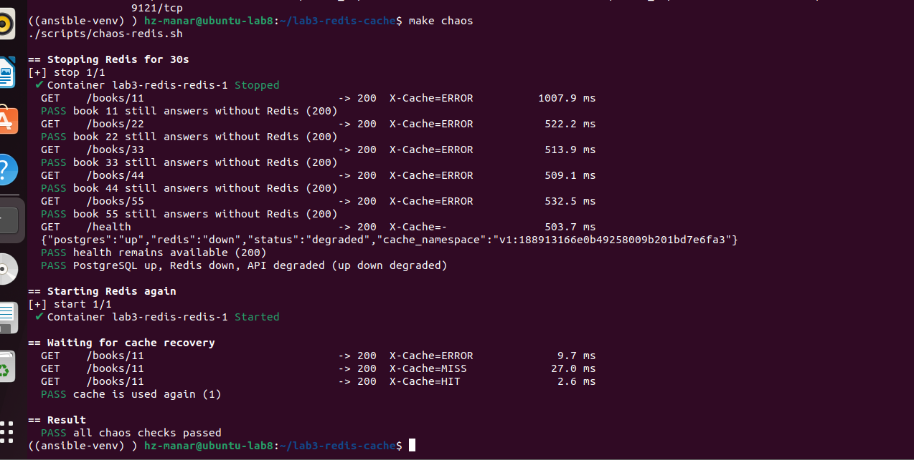

*Redis outage test: reads fall back to PostgreSQL, /health reports degraded, and the cache recovers after Redis restarts.*

I separately checked price validation through the HTTP API. Values `0.001`, `12.345`, `0`, `-1` and `100000` were rejected with HTTP 422. A price of `12.34` was accepted and read back correctly with both cache modes, after which I restored the original price. This confirmed that invalid precision and out-of-range input were rejected at the API boundary.

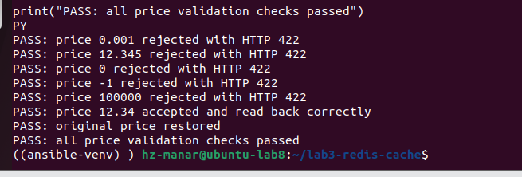

*HTTP price-validation checks, acceptance of 12.34, and restoration of the original price.*

## What I concluded

In this experiment, Redis was most useful when it avoided repeated aggregate work and allowed concurrent readers to share one result. The successful mixed-load run showed lower average and p95 latency, while the stampede test showed a direct reduction in database loader attempts. The outage test showed that a cache could be temporarily unavailable without immediately taking catalogue reads offline.

The limits are equally relevant to interpreting these results. This deployment uses one API process and one Redis instance, without Sentinel or Cluster. Its process-local namespace strategy is not coordinated across multiple API workers. Writes and cache invalidation are separate operations, so I do not claim transactional consistency across PostgreSQL and Redis. A slow loader can also outlast the waiting budget and cause additional database reads. Under sufficiently high load, fallback still depends on available database capacity.

My result is a working, monitored cache-aside service with reproducible functional, concurrency, load and outage experiments. The evidence shows where caching helped, where a cheap direct database read remained competitive, and why I needed both client-side measurements and internal metrics to interpret the outcome.
