# Lab 4: ClickHouse + Grafana, request analytics for Online Boutique

For this lab I picked the **service metrics and logs** level. The data is a request log of the 10 microservices from Google's Online Boutique (frontend, cart, checkout, payment, shipping and so on). It is the same shop we drew on the whiteboard in the first lecture, so I already knew which services exist and how they call each other.

Everything is deployed with one Ansible playbook, `ansible/lab4.yml`, on the same Ubuntu 22.04 VM where labs 2 and 3 live. ClickHouse is installed from the official APT repository and runs as a systemd service, without Docker. Grafana is the same 13.2.3 instance from lab 2, and the playbook only adds a new folder "NBD Lab 4" to it.

## What the system should answer

Before writing any SQL I wrote down the questions an on-call engineer would ask about this shop:

1. How many requests per second does each service handle, and how does it change during the day?
2. What share of requests fails with 5xx, and which service or endpoint is responsible?
3. What is the latency (p50, p95, p99), and which endpoints are the slowest?
4. Are we inside the SLO (99.5% availability), and how much error budget is left?
5. Did a specific deploy make things worse?
6. Is one pod broken while the others of the same service are fine?
7. Which errors happen most often, and in which region?

## Metrics and why I chose them

| Metric | Why |
|---|---|
| Requests per second | The "R" of RED. Shows load and the daily wave |
| 5xx share | The "E" of RED. 5xx is our fault. 4xx is counted separately, because that is usually the client's fault |
| p50 / p95 / p99 latency | The "D" of RED. I don't use the average, because it hides the slow tail |
| Availability and error budget | One number that answers "are we OK?" (SLO 99.5% means a 0.5% budget) |
| Unique users | A business number next to the technical ones |
| p95 and errors per pod | To tell a bad pod from a bad release |
| Deployments and rollbacks | To connect a change with a degradation (shown as Grafana annotations) |

## Architecture

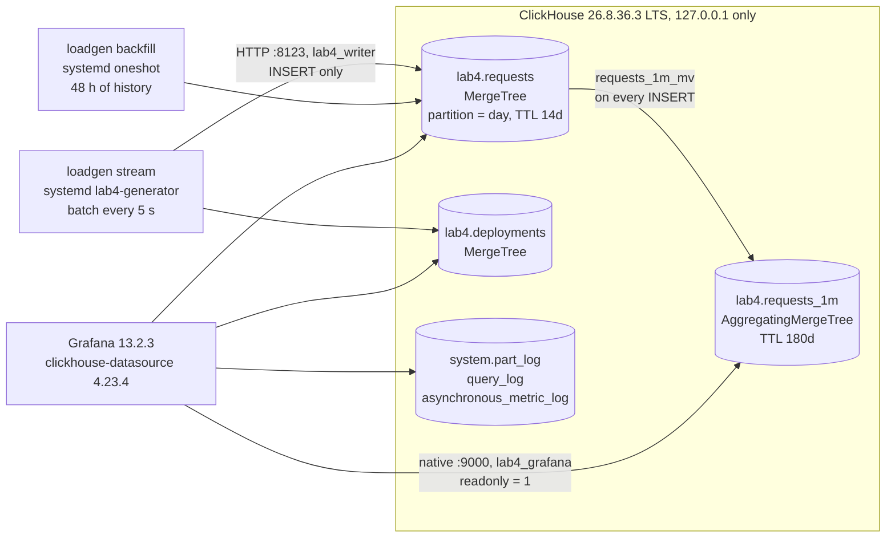

| Role | What it does |
|---|---|
| `clickhouse` | checks RAM and ports, adds the APT repo (`lts`), installs 26.8.36.3 and holds it, writes config and users, verifies |
| `schema` | runs `sql/schema/*.sql`, checks the engines, runs the access matrix |
| `generator` | Python venv, `lab4gen` system user, systemd units, 48 h backfill on the first run, verifies the pipeline |
| `grafana` | checks the Grafana version, installs the ClickHouse plugin, provisions the data source and two dashboards |

## How I ran it

Before starting I stopped the lab 3 Docker stack (`docker compose down`), because the VM has 11 GiB of RAM and OpenSearch from lab 2 already takes a big part of it. After that there were 5.2 GiB available.

```bash
cd ~/lab4-clickhouse/ansible
cp group_vars/all/vault.yml.example group_vars/all/vault.yml   # 3 passwords from openssl rand -hex 16
ansible-vault encrypt group_vars/all/vault.yml
ansible-playbook lab4.yml --syntax-check
sudo ~/ansible-venv/bin/ansible-playbook lab4.yml --ask-vault-pass            # parts 1-4
sudo ~/ansible-venv/bin/ansible-playbook lab4.yml --ask-vault-pass --tags report
sudo ~/ansible-venv/bin/ansible-playbook lab4.yml --ask-vault-pass --tags experiment
```

Each part has its own tag (`part1` ... `part4`), so I ran them one by one and checked the output after each. Why I ended up running `ansible-playbook` under `sudo` instead of `-K` is in the "What took time" section below.

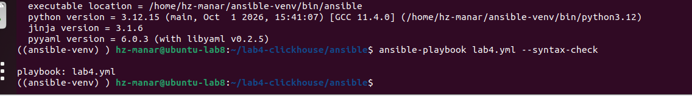

### Part 1: ClickHouse

The last task reads the state back from the server: the version, that both lab users exist, that a request without a password is rejected, and that ClickHouse listens only on 127.0.0.1.

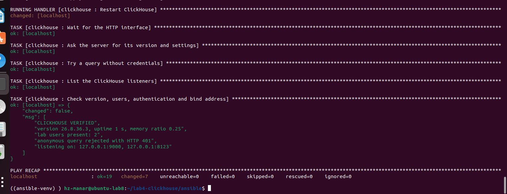

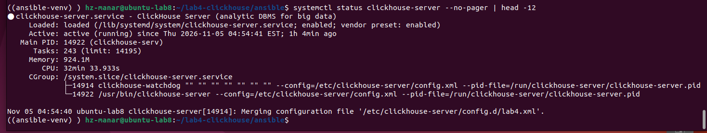

### Part 2: tables and users

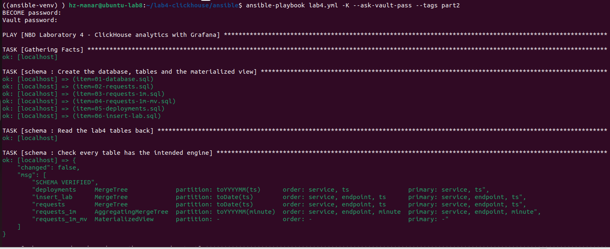

I have three users:

- `default` is the admin. Its password comes from the vault and it can only connect from localhost.
- `lab4_writer` can only `INSERT` into three tables. The generator uses it.
- `lab4_grafana` has `readonly = 1` and `SELECT` on `lab4.*` and `system.*`. The ClickHouse docs say the Grafana plugin needs to change `max_execution_time`, so only that setting is `changeable_in_readonly`.

A role that exists proves nothing, so the playbook sends real queries as each user and compares the HTTP code with what I expect:

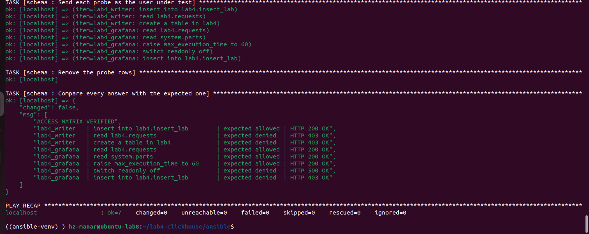

I also tried an INSERT as `lab4_grafana` by hand. I expected a `READONLY` error, but got `ACCESS_DENIED` (code 497). ClickHouse checks grants before it looks at readonly, and this user has no INSERT grant at all. So it is protected twice.

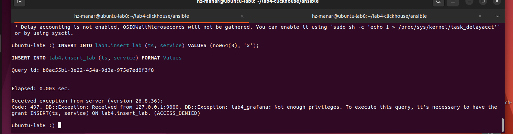

### Part 3: data collection

There was no real shop to collect logs from, so I wrote a generator in Python (`generator/loadgen`, using `clickhouse-connect` 1.12.0). It is not just random numbers:

- Traffic follows a daily wave: low at night (UTC), high in the afternoon.
- Latency follows a lognormal distribution per endpoint. `PlaceOrder` is slow because in the real shop it calls other services, and `Convert` is fast.
- There are three regions with different network delays.
- Each service gets about 2.4 deploys a day. About a third of them are "bad": errors go up 12 to 30 times, latency 2 to 3.5 times, and after 6 to 25 minutes a rollback follows.
- Sometimes one pod degrades without any deploy, like a noisy neighbour.

On the first run a `oneshot` systemd unit fills 48 hours of history. After that `lab4-generator.service` writes a batch every 5 seconds.

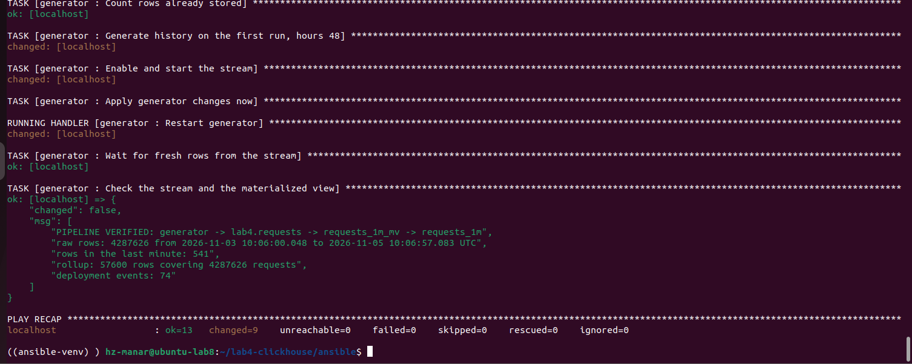

The backfill wrote **4,287,626 rows in 42.2 s (101,712 rows/s)**:

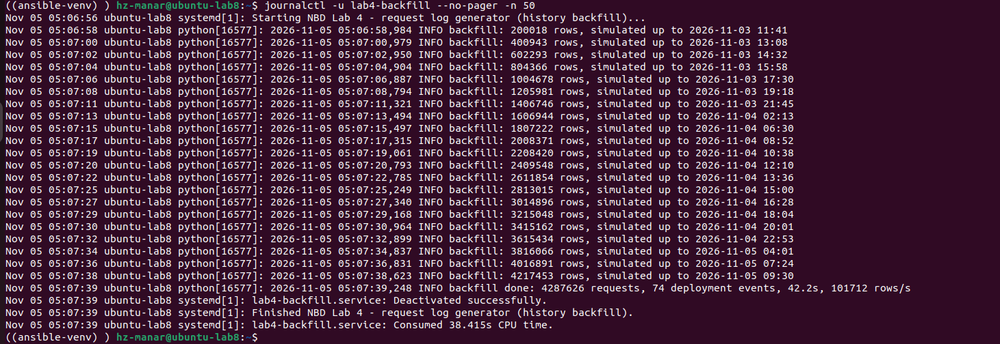

The stream writes about 2,150 rows a minute in 12 batches:

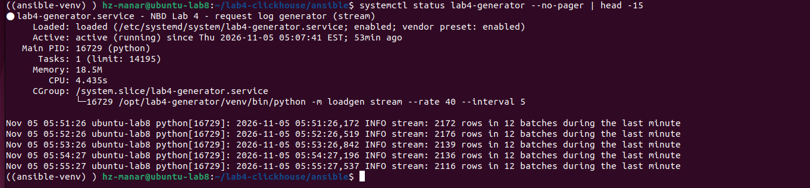

### Part 4: Grafana

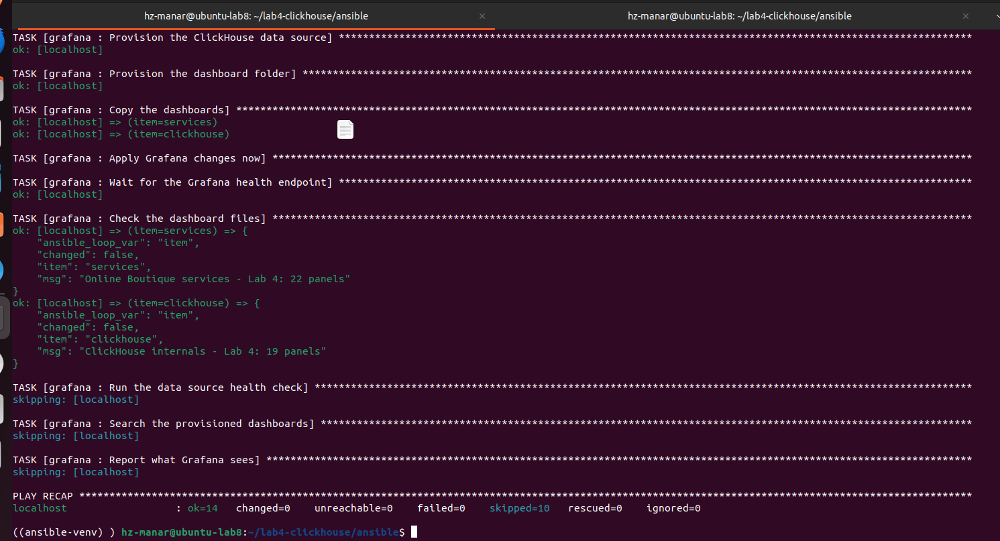

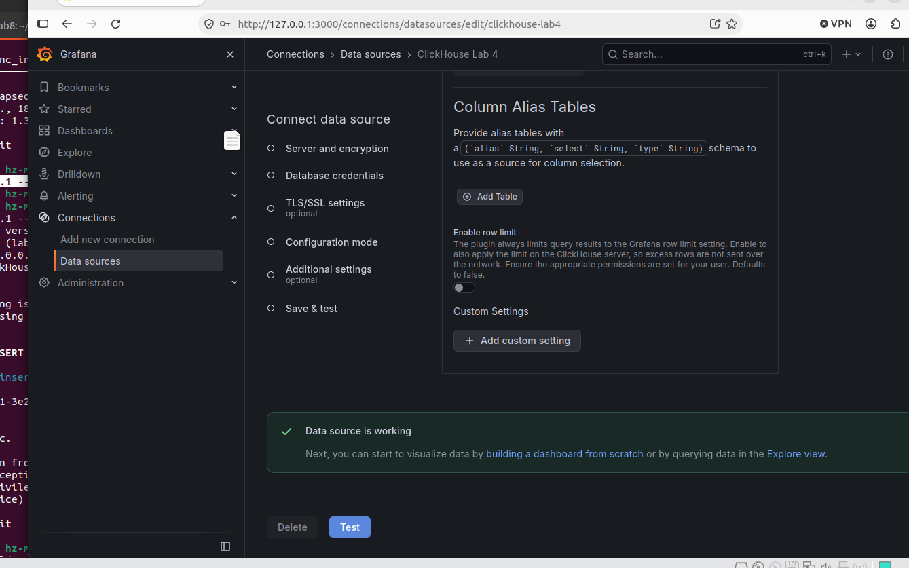

### Second run

I ran the whole playbook again, and nothing changed (`ok=47 changed=0`). So it is safe to run it again any time.

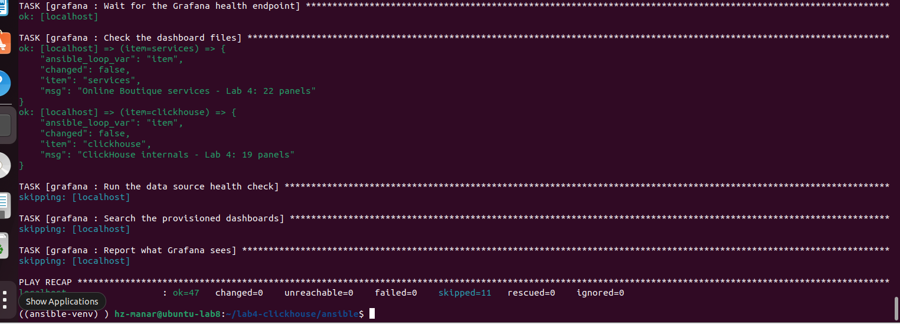

## Table design

This is the part I thought about the most.

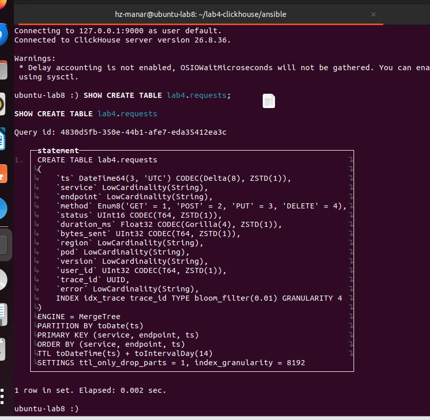

### `lab4.requests` (MergeTree)

**ORDER BY (service, endpoint, ts)** and **PRIMARY KEY (service, endpoint, ts).** Almost every panel filters by service (and often endpoint) and then by a time range. There are only 10 services and 20 endpoints, so the low-cardinality columns go first and time goes last. Rows of the same endpoint lie next to each other on disk, and that also helps compression. The primary key is sparse: one mark per 8192 rows (one granule).

**PARTITION BY toDate(ts).** One partition per day. A time filter can skip whole days, and old data is removed by dropping a whole partition instead of deleting rows one by one. This is what we discussed in the lecture about DROP PARTITION.

**TTL 14 days with `ttl_only_drop_parts = 1`.** Old parts are dropped whole, so cleaning is cheap.

**Types:**

- `LowCardinality(String)` for service, endpoint, region, pod, version and error. There are few distinct values, so they are stored as a dictionary.
- `Enum8` for method: one byte.
- `DateTime64(3, 'UTC')` for time: milliseconds, and UTC so time zones cannot confuse anything.
- `UInt16` for status, `UInt32` for bytes and user_id: the smallest type that fits.

**Codecs:** `Delta + ZSTD` for time (it only grows, so the differences are small), `T64 + ZSTD` for integers, `Gorilla` for the float latency. A `bloom_filter` skip index on `trace_id` lets me find one request by its trace.

The result per column:

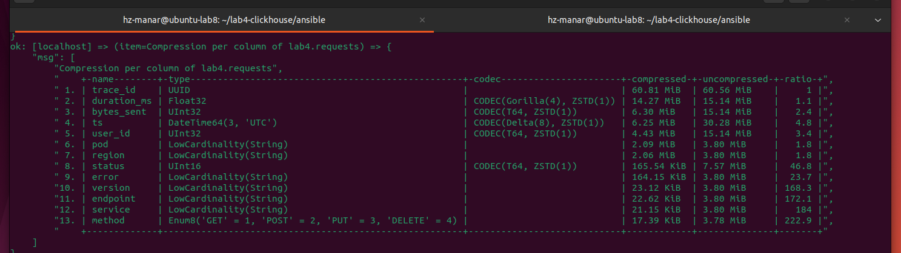

The low-cardinality columns compress 170 to 220 times, and time compresses 4.8 times. But **`trace_id` (UUID) does not compress at all (ratio 1)**. It takes 60.8 MiB of the 112 MiB table, more than half. A random UUID has nothing to compress. I knew random IDs are expensive, but seeing that one column is half the table was a surprise. In a real system I would think twice before storing a full trace id in every row of an analytics table.

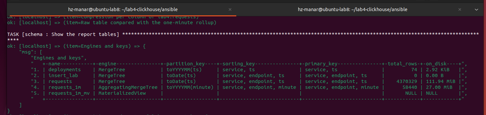

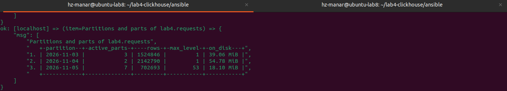

The two backfilled days have 2 or 3 parts with level 1, because the backfill wrote big batches. The current day has 7 parts with level 53, because the stream writes every 5 seconds and ClickHouse keeps merging in the background. On disk it looks like this (`partition_minBlock_maxBlock_level`):

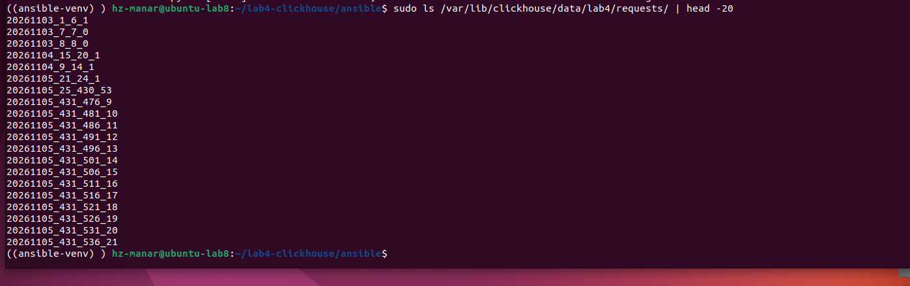

### Does the primary key actually help?

This query asks for one endpoint in the last hour:

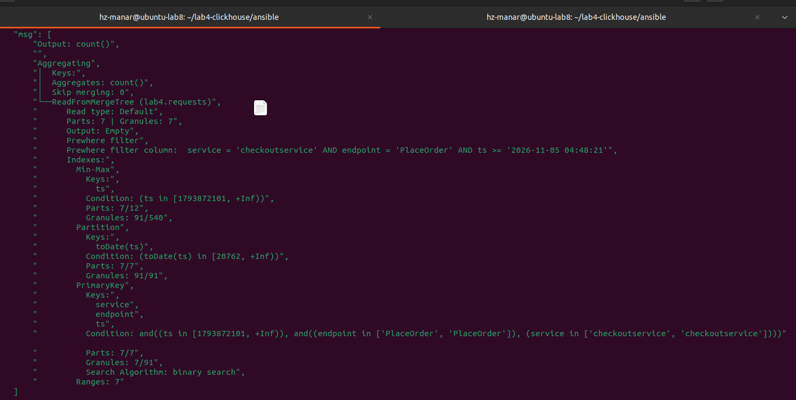

The Min-Max index on `ts` leaves 91 granules out of 540. Then the primary key (binary search) leaves **7 out of 91**. So ClickHouse reads about 1.3% of the table.

### `lab4.requests_1m` (AggregatingMergeTree) + materialized view

On every INSERT into `requests`, the MV `requests_1m_mv` computes one row per minute per service and endpoint. The counters (requests, errors, bytes) are `SimpleAggregateFunction(sum)`. Percentiles and unique users can't be added together, so they are stored as states: `quantilesTDigestState` and `uniqState`. The MV runs as `SQL SECURITY DEFINER`, so the writer doesn't need any rights on the rollup table.

The rollup keeps data for 180 days, while the raw table keeps only 14. Old history survives in aggregated form.

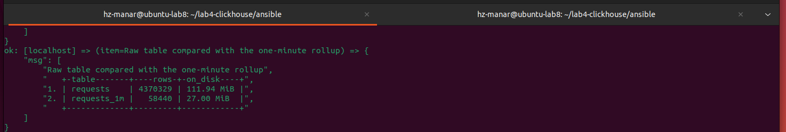

The rollup has 75 times fewer rows, but it is only 4 times smaller on disk. Each row stores aggregate states (a t-digest and a uniq sketch), and these are much bigger than a plain number. What matters is how much a query has to read. Here is the same question (p95 and errors per service for 24 hours) on both tables:

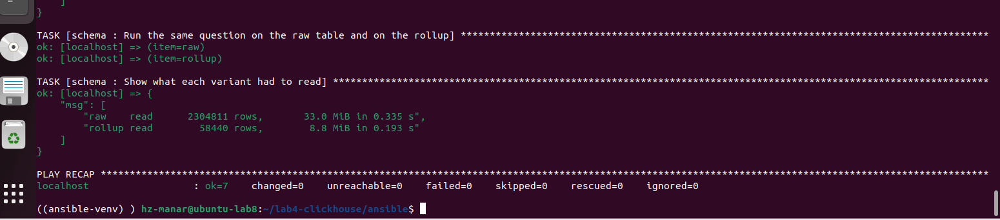

The raw table read 2.3 million rows, the rollup 58 thousand. That is why the main dashboard queries the rollup.

### `lab4.deployments` (MergeTree)

A small table of deploy and rollback events. The dashboard uses it for annotations.

## Insert experiment: why we write in batches

In the lecture we talked about every INSERT creating a new part. I wanted to see it. The `experiment` tag inserts the same 300 rows into `lab4.insert_lab` in three ways, with background merges stopped:

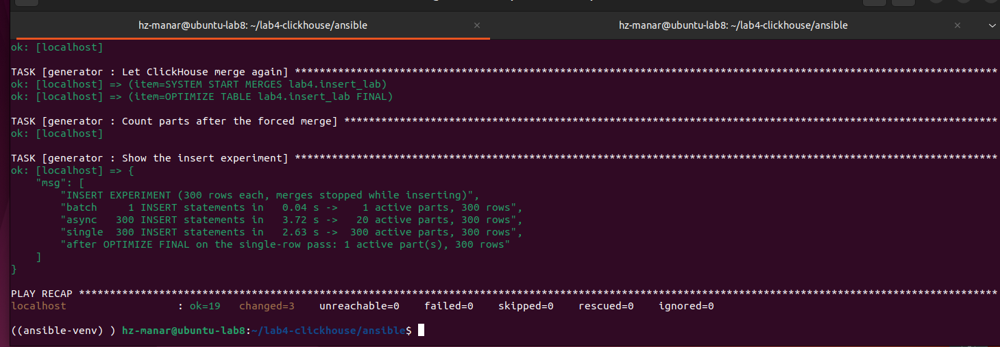

| How | INSERT statements | Active parts |
|---|---|---|
| one batch | 1 | **1** |
| async insert (20 clients) | 300 | **20** |
| one row per INSERT | 300 | **300** |
| after `OPTIMIZE FINAL` | | **1** |

300 small inserts gave 300 parts. ClickHouse would have to merge all of them later, and that costs CPU. Async insert collected the rows on the server side and wrote only 20 parts.

One thing surprised me while I was doing this: in ClickHouse 26.8, `async_insert` is **on by default**.

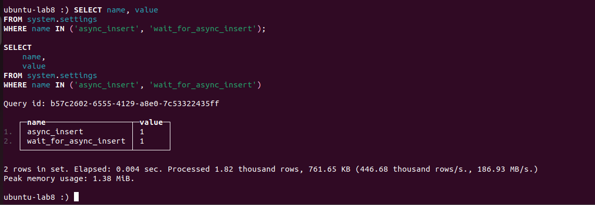

That is why the generator sets `async_insert = 0` explicitly. It already builds its own batches, so there is no reason to wait for the server buffer. The experiment does the same for the "one row" mode, otherwise ClickHouse would merge the rows itself and the experiment would show nothing.

The parts log shows the same thing over 30 minutes: inserts create parts, merges combine them, and the old ones get removed.

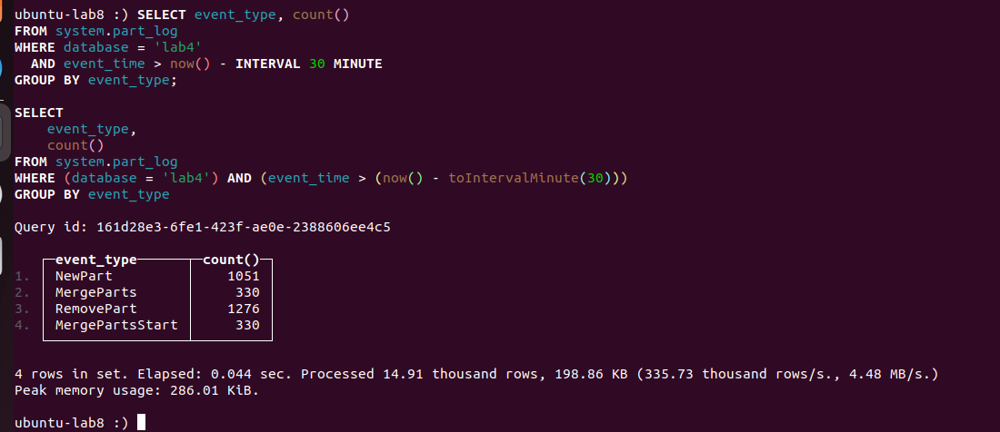

## Dashboards

### Online Boutique services

The first row answers "are we OK?" for the selected range:

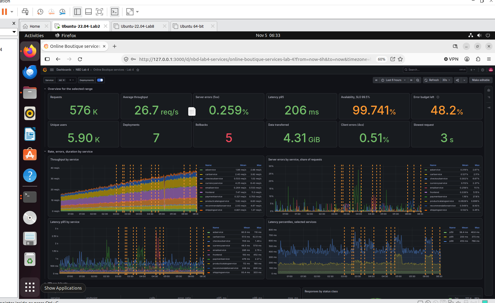

For the last 6 hours: 576K requests, 0.259% server errors, p95 206 ms, and **availability 99.741%** (orange, because it is under 99.8%). **The error budget was 48.2%**: half of it was already used, because there were 7 deploys and 5 of them were rolled back.

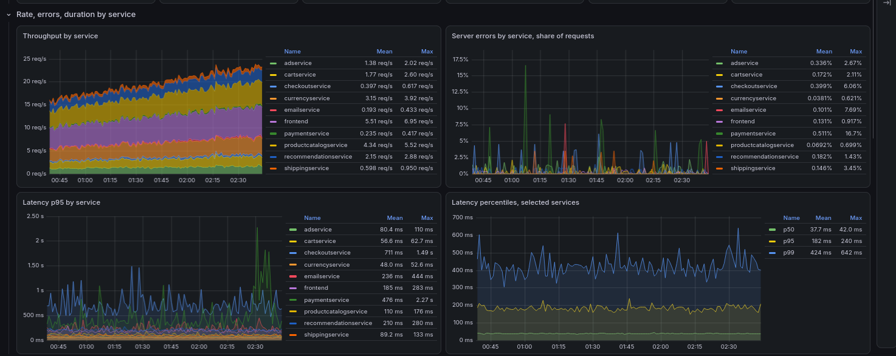

**The best example I found was paymentservice.** I filtered the dashboard to only this service and hovered over the first orange line:

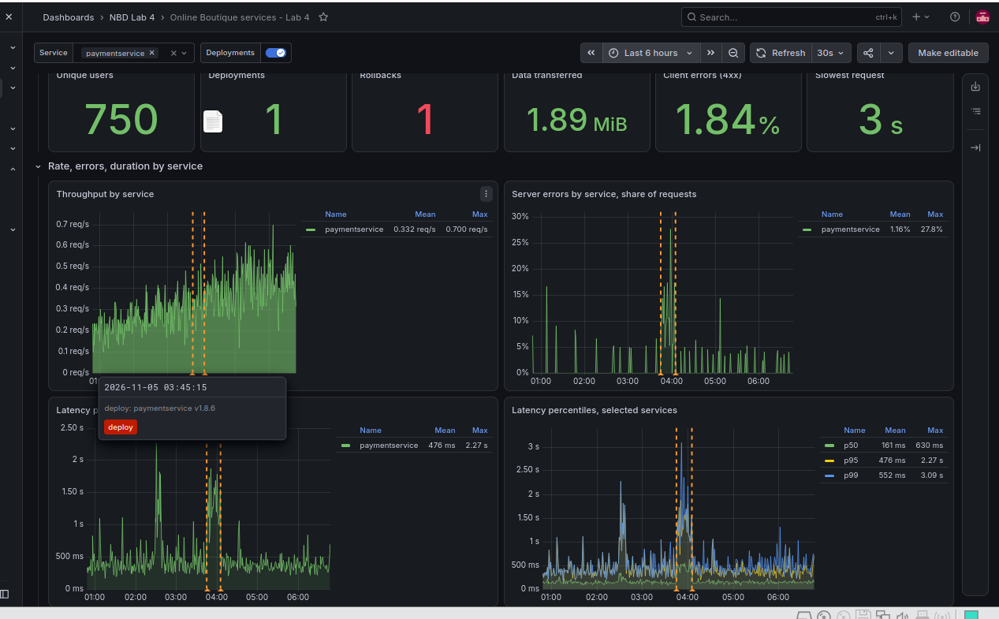

At **03:45** version **v1.8.6** was deployed. Right after it, server errors jumped from about 1% to **27.8%**, and p95 went to almost 2 seconds. About 20 minutes later the second line is the rollback, and everything is normal again. With "All" selected this spike was hard to see among 9 other services. With the filter it is obvious.

The "Where it hurts" row confirmed that it was the release and not a pod. **All three paymentservice pods on v1.8.6** had about 11% errors. If only one pod had been bad, the other two would be green. The same story is visible for emailservice: v1.2.8 deployed at 04:33, rolled back at 04:43.

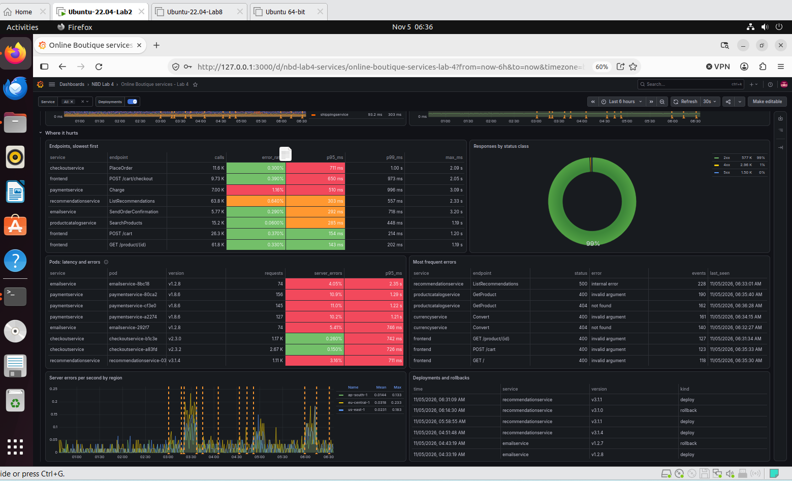

I also saw the other kind of problem: around 02:30 paymentservice latency went up to 2.27 s with no deploy at all. This looks like the "one degraded pod" case.

Over 2 days the daily wave is clearly visible: about 8 req/s at night and about 40 req/s in the afternoon. In 2 days there were 46 deploys and 24 rollbacks.

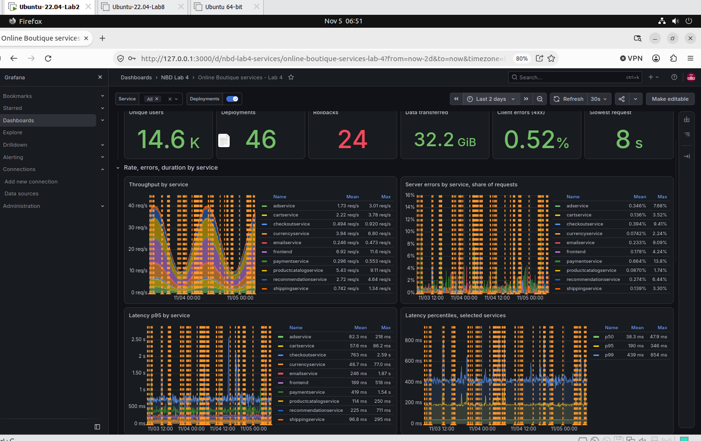

### ClickHouse internals

The second dashboard watches ClickHouse itself, using only its own system tables (`system.parts`, `system.columns`, `system.part_log`, `system.query_log`, `system.asynchronous_metric_log`). It needs no extra exporter.

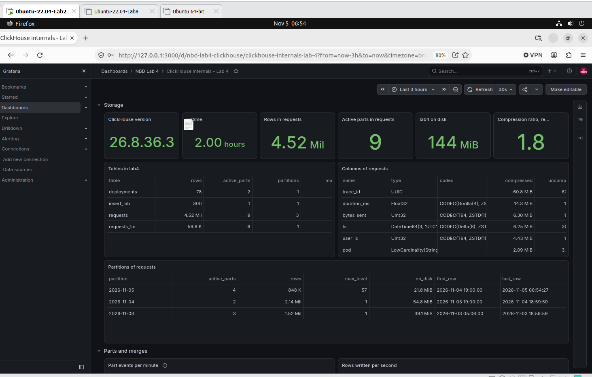

The experiment is visible here too. `MaxPartCountForPartition` jumps to **300** at the moment of the single-row inserts, and right after it `RemovePart` jumps when the old parts are deleted after `OPTIMIZE FINAL`.

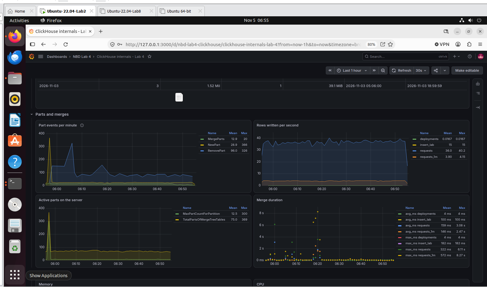

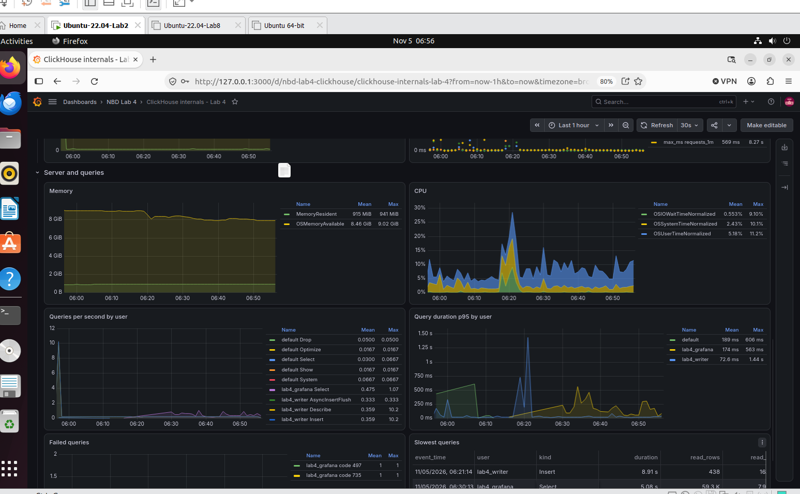

ClickHouse uses about 915 MiB of RAM. I limited it to 25% of the VM's memory, because the VM is shared with the other labs. "Queries per second by user" separates the generator (`lab4_writer Insert`), the dashboards (`lab4_grafana Select`) and Ansible (`default`). There is even `AsyncInsertFlush` from the experiment.

Around 06:20 the CPU went up, merges took 6 to 8 seconds, and the slowest query in the table was an INSERT from the generator that took **8.9 s**. Heavy background merges slowed the writes down for a moment. In the lecture this was theory; here I could see it on a graph.

A plain SQL query from the console, for comparison:

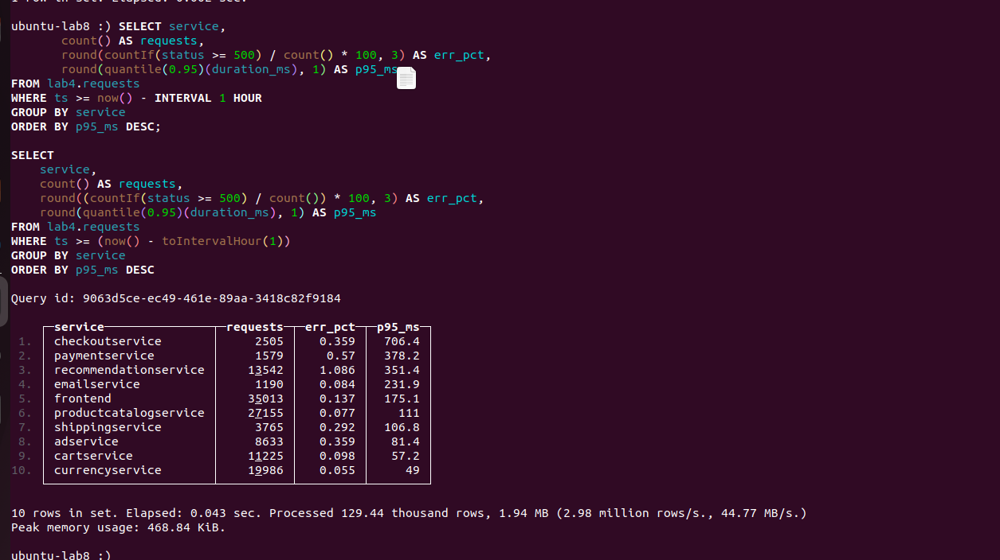

## What took time

The playbook itself worked on the first try for parts 1 to 3. Most of the time went into the VM, not into ClickHouse.

**Ansible ignored my `ansible.cfg`.** When I unzipped the project, all directories were world-writable (777), and Ansible printed that it ignores the config in a world-writable directory. I didn't notice it at first. `chmod 755` on the directory fixed it.

**Grafana did not come back after the restart.** The playbook installs the plugin, restarts Grafana and waits for `/api/health`. It waited 90 seconds and failed with "connection refused". `systemctl status` said Grafana was running, but it didn't answer. In `journalctl` I saw that it was loading plugins one by one, and some of them took more than 2 minutes. `top` showed 0% idle CPU: OpenSearch from lab 2 and MongoDB from lab 1 were running at the same time. I stopped them, and Grafana came up in less than a minute. I raised the wait in the playbook to 10 minutes, because 90 seconds is not enough on a VM that runs three labs at once.

**"Timed out waiting for become success".** This appeared randomly, on different tasks, even after I raised `timeout` to 60. Ansible sometimes doesn't catch the sudo password prompt when it runs on the same machine (`ansible_connection=local`). In the end I ran `ansible-playbook` itself under `sudo`, without `-K`. Then there is no prompt to catch, and the problem disappeared.

**Vault password "wrong".** Several runs failed with "Decryption failed". The password was right, but my keyboard layout had switched. I found it when random letters appeared in the terminal.

**`clickhouse-client` said "password is incorrect".** The admin password is 32 random characters and I mistyped it. Instead of typing it, I read it from the vault into a variable:

```bash
CH_PW=$(ansible-vault view group_vars/all/vault.yml | awk -F'"' '/vault_clickhouse_admin_password/{print $2}')
clickhouse-client --host 127.0.0.1 --password "$CH_PW"
```

## What I learned

The thing that stays with me is how much the design depends on the questions. ORDER BY, PARTITION BY and the rollup were all chosen from the list at the top of this report. And I could check each choice with numbers: 7 granules out of 91 in EXPLAIN, 58 thousand rows instead of 2.3 million, 1 part instead of 300.

Also, half of my table is one UUID column. I would not have guessed that without `system.columns`.

## Limitations

- One ClickHouse node, no replication. The lecture showed `ReplicatedMergeTree` with Keeper/Raft. That would be the next step.
- The data is generated. The patterns are realistic, but it is not a real shop.
- No alerts yet. The obvious ones: error budget below 25%, p95 above 400 ms, `MaxPartCountForPartition` above 300.
