# Lab 5: Qdrant, semantic product search for an online furniture shop

For the last lab I picked a **vector database** and built a search service for a shop catalogue. The idea is simple: a customer does not type the exact product name, they type what they want, like "comfy reading chair", "outdoor dining set" or even in Russian "мягкий диван для гостиной". A normal keyword search fails as soon as the words are different. Semantic search compares the meaning instead: the text becomes a vector, and the shop returns the products whose vectors are closest.

Everything is deployed with one Ansible playbook, `ansible/lab5.yml`, on the same Ubuntu 22.04 VM where labs 2, 3 and 4 live. Qdrant is installed from the official `.deb` release and runs as a systemd service, without Docker. Grafana is the same 13.2.3 instance from the earlier labs, and the playbook only adds a new data source and a folder "NBD Lab 5".

## Task and requirements

What the search service has to do:

1. Return relevant products for a free text query, even when the query uses other words than the catalogue.
2. Work for Russian queries on an English catalogue.
3. Filter by category and rating in the same request ("only Outdoor, rating 4.5 or more").
4. Answer in under 100 ms at p95 for a single user.
5. Quality must be measured with numbers, not "looks fine to me".
6. The search service must not be able to change or delete data.
7. Everything must be monitored, with alerts when something breaks.

## Why a vector database, and why Qdrant

The core operation here is "find the nearest vectors to this one, among thousands, fast, with a filter". A relational database can do a full scan, but it gets slow and has no good approximate index. I compared the options I knew:

| Option | Why not / why yes |
|---|---|
| PostgreSQL + pgvector | Works, but filtering together with the HNSW index is limited, and hybrid (vector + BM25) needs extra work |
| OpenSearch k-NN (lab 2) | Possible, but it is a heavy JVM cluster. On my VM it already took most of the CPU in lab 4 |
| Milvus | Needs etcd, MinIO and several components, too much for one VM |
| **Qdrant** | One binary, HNSW with filtering inside the index, sparse vectors with IDF for BM25, hybrid search with RRF in one query, read-only API keys, snapshots and a Prometheus `/metrics` endpoint out of the box |

Qdrant covers all seven requirements without extra services, so I chose it.

## Data

I used **WANDS** (Wayfair ANnotation DataSet), an open dataset from Wayfair under the MIT licence. It has:

- 42,994 real products with name, class, category path, description, rating and number of reviews;
- 480 real search queries from customers;
- 233,448 human judgements for query and product pairs: **Exact**, **Partial** or **Irrelevant**.

The judgements are the main reason I picked it: they let me measure search quality properly, like a real shop would.

The playbook downloads the three CSV files from GitHub at a pinned commit and checks their sha256, so nothing has to be copied by hand. Embedding all 43k products on the VM CPU would take around half an hour, so I load a **12,000 product catalogue**:

- 60 queries with at least one Exact product are picked with a fixed seed. These are the evaluation set.
- All their Exact products go into the catalogue, plus their Partial and Irrelevant products as hard "competitors".
- The rest is filled with random products from the whole dataset.

The size can be changed with `-e catalog_size=...`.

## Architecture

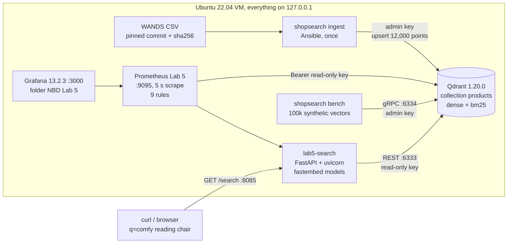

| Service | Port | Runs as |
|---|---|---|
| `qdrant` | 6333 (REST), 6334 (gRPC) | user `qdrant` |
| `lab5-search` | 8085 | user `lab5search` |
| `prometheus-lab5` | 9095 | user `prometheus` |
| `grafana-server` | 3000 | from the earlier labs |

I started a separate Prometheus on 9095 instead of editing the lab 2 Prometheus on 9090, so lab 5 can be removed without touching lab 2.

**Two keys.** Qdrant has an admin key and a read-only key, both in Ansible Vault:

- The admin key is used only by the ingest, the bench and the snapshot.
- The search API and Prometheus get only the read-only key.

So even if the API had a bug, it could not delete the collection.

## Data organisation

One collection, `products`. One point is one product, and the point id is the WANDS product id. Every point has two named vectors and a payload:

| Part | Configuration | Why |
|---|---|---|
| `dense` vector | 384 dims, Cosine, HNSW m=16, ef_construct=128 | Meaning. Model `paraphrase-multilingual-MiniLM-L12-v2` (fastembed, ONNX on CPU). It is multilingual, which is why Russian queries work |
| `bm25` sparse vector | modifier `idf`, computed by Qdrant | Exact words, model names, colours ("turquoise"). IDF is kept up to date by Qdrant when points are added |
| payload | `name`, `product_class`, `category`, `path`, `description`, `rating`, `reviews` | Shown in results and used in filters |
| payload indexes | `category` keyword, `product_class` keyword, `rating` float, `reviews` integer | So filters are applied inside the HNSW search, not after it |
| storage | `on_disk_payload: true`, `indexing_threshold: 1000` KB | Payload stays on disk, RAM is used for vectors and the graph. The low threshold makes sure HNSW is really built for a 12k collection |

The text that is embedded is the product name, the class, the category path and the first 24 words of the description. I cut the description because embedding time grows with the text length, and the first words carry most of the meaning.

**Three search modes, one API:**

- `dense` sends a `query_points` call with `using="dense"`;
- `sparse` does the same with `using="bm25"`;
- `hybrid` uses the Query API with two `prefetch` queries (dense and bm25, 20 candidates each) merged by **RRF** (`k=60`) inside Qdrant in one request.

The filter is passed into each prefetch, so it works for all three modes.

The ingest report shows the result straight from Qdrant:

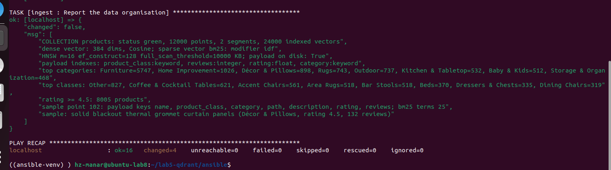

Status green, 12,000 points in 2 segments, and 24,000 indexed vectors (every product is in the HNSW graph and in the sparse index). Furniture is the largest category (5,747), and 8,005 products have a rating of 4.5 or more.

## How I ran it

Before starting I stopped the heavy services from the earlier labs (the three OpenSearch nodes, Dashboards, Fluent Bit, MongoDB and the lab 4 generator). In lab 4 they kept the CPU at 100%. I wrote the two Qdrant keys with `openssl rand -hex 24`, put them in `group_vars/all/vault.yml` and encrypted it with `ansible-vault`.

I did not know the Grafana admin password any more. It was empty in the lab 4 vault, so I reset it with `grafana cli admin reset-admin-password` and put the new one in the vault.

The playbook is split into tags, so I ran it part by part and checked every part before going on.

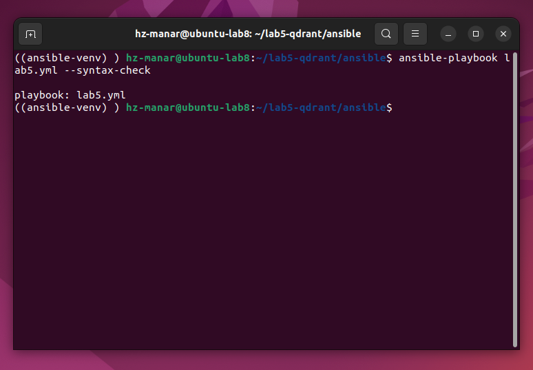

### Part 1: Qdrant

`--tags part1` installs the `.deb` (sha256 checked), creates the `qdrant` user, writes the config with both keys, and starts the systemd unit. Then it checks itself:

- the version is 1.20.0;
- it listens only on 127.0.0.1;
- the access rules: no key → 401, read key list → 200, read key create → 403, admin key → 200.

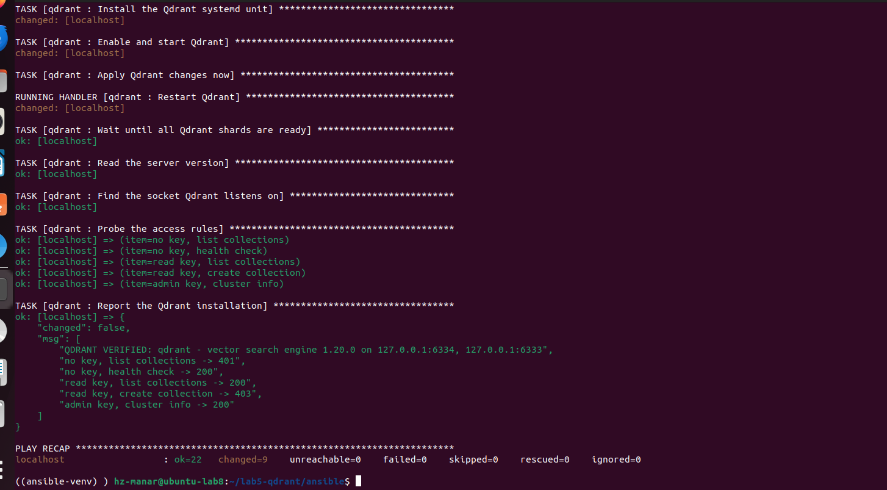

### Part 2: models and data

While part 2 was running, my laptop battery died and the whole machine switched off in the middle of the task. After booting again I had to stop OpenSearch once more, because those services start automatically, and then I ran `--tags part2` again. It continued without problems, because every step checks what already exists. For example, the ingest only runs if the collection does not have the expected number of points. During that run Ubuntu also offered an upgrade to 24.04. I declined it, because it would change Python and could break all four labs on this VM.

The two models (about 240 MB) were downloaded once in 286 s. Then the 12,000 products were embedded at **28 products per second**: 428 s for the dense vectors, 1.2 s for BM25 and 4.8 s for the upsert. The dense model is clearly the expensive part.

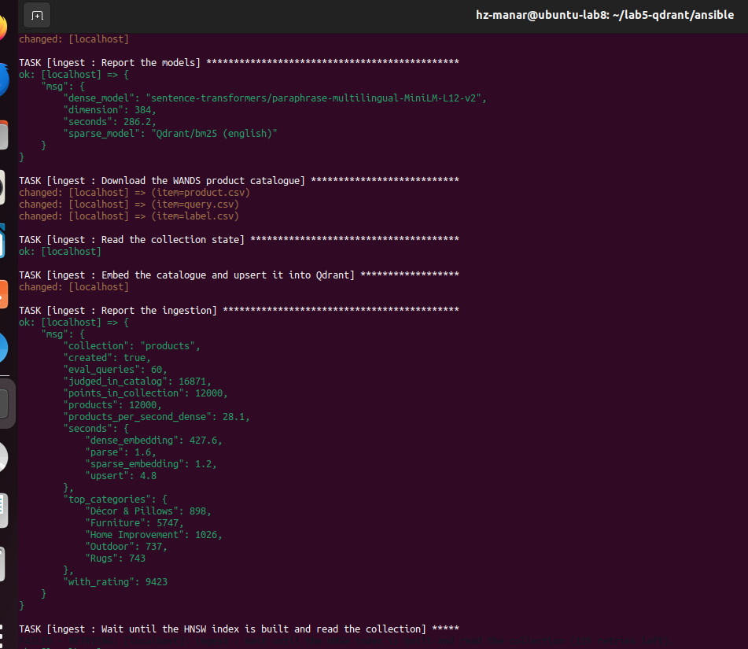

### Part 3: search API

`--tags part3` installs the systemd unit for the API with the read-only key in an env file (mode 0640), starts it, and runs four sample searches:

- hybrid;
- dense with a **Russian** query;
- sparse;
- hybrid with the filter `category=Outdoor, min_rating=4.5`, where the playbook checks that all hits are really Outdoor and rated 4.5 or more.

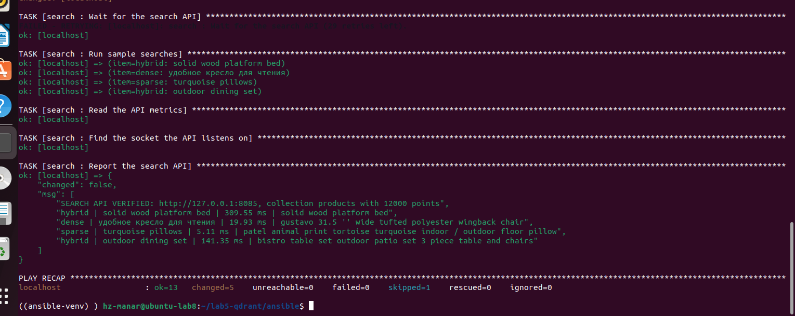

"удобное кресло для чтения" returned a wingback chair from an English catalogue. The first request took 309 ms because it was the first one after the service started. On the second run the same searches took 3 to 18 ms.

### Part 4: monitoring

`--tags part4` creates Prometheus Lab 5 with a Bearer credentials file for Qdrant (read-only key), recording rules and alerts, checks the config with `promtool`, and provisions the Grafana data source and dashboard.

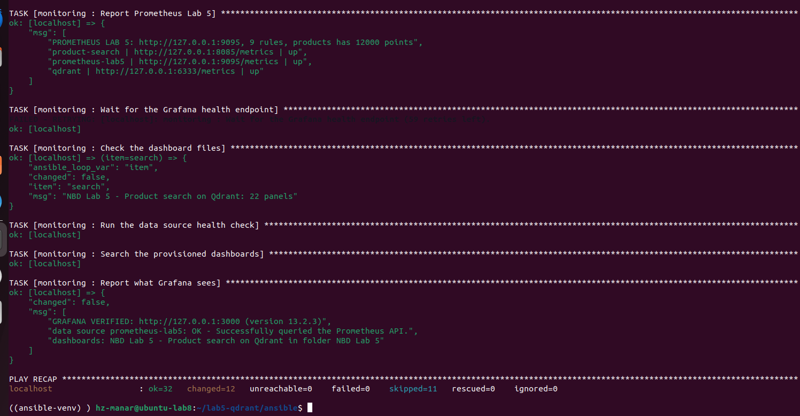

All three targets are up, 9 rules are loaded, Grafana's data source health check says OK, and the dashboard has 22 panels. The new folder sits next to the folders of the earlier labs:

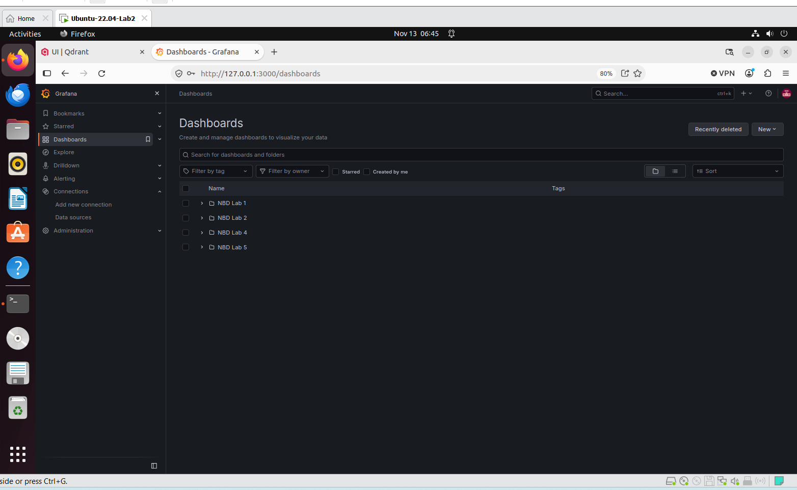

### Second run

The full playbook again: `ok=72 changed=0 failed=0`. Nothing was reinstalled and the products were not embedded again.

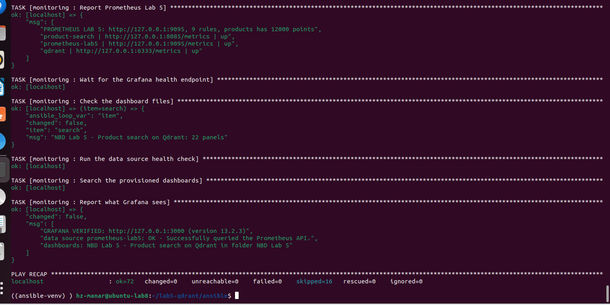

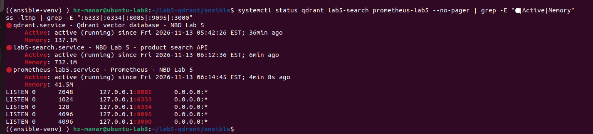

All three services are active, and every port is bound to 127.0.0.1. Memory:

- Qdrant: 137 MB;
- the API: 732 MB (mostly the two ONNX models);
- Prometheus: 42 MB.

## Trying the search by hand

A plain request returns the products together with the time split into `embed` (the model) and `qdrant` (the database):

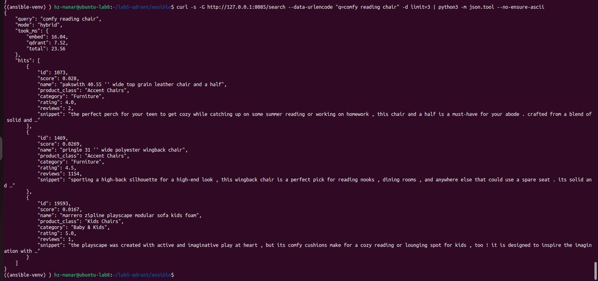

The very first request I sent took 925 ms, and 897 ms of it was Qdrant. Repeating the same request gave 23.6 ms (16 ms embed, 7.5 ms Qdrant):

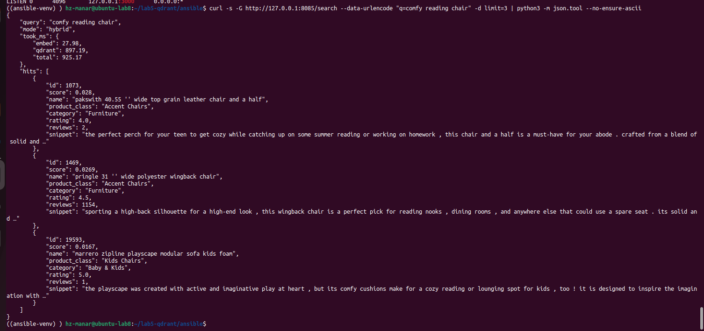

The reason is `on_disk_payload`: the first time, Qdrant reads the payload from the VM disk, and later it is in the page cache. It is a good example of why p99 matters and why a service should be warmed up after a restart.

The same query in the three modes, a Russian query and a filtered query:

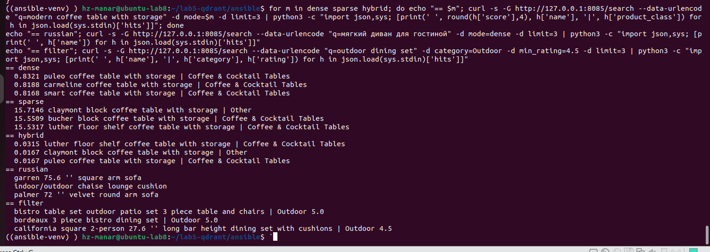

- The modes return different scores: cosine about 0.83 for dense, BM25 about 15.7 for sparse, RRF about 0.03 for hybrid. Hybrid moved "luther floor shelf coffee table with storage" to the top because it was high in both lists.
- "мягкий диван для гостиной" returned two sofas, although the word "диван" is not in any product.
- The filter returned only Outdoor products rated 4.5 or more.

**Access check.** I read the read-only key from the vault into a shell variable, so it never appears on screen:

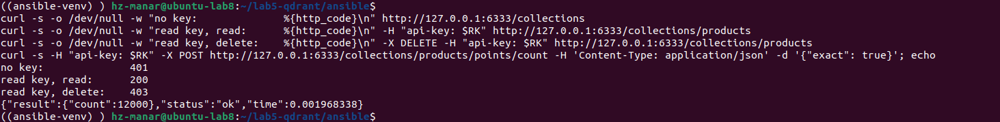

No key → 401. Read key, reading the collection → 200. Read key, `DELETE` of the collection → 403. Counting afterwards still gives 12,000 points.

## Qdrant web UI

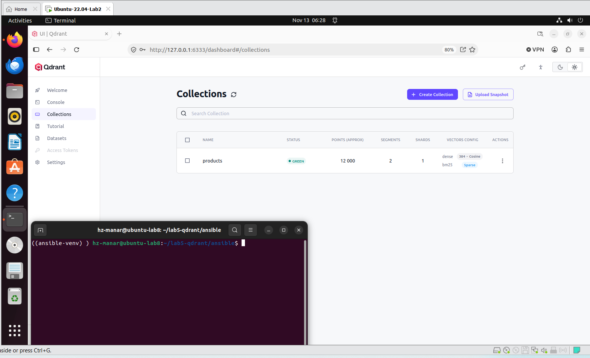

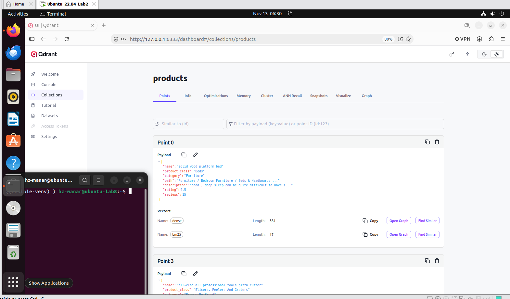

Every point shows the payload and both vectors: `dense` with length 384 and `bm25` with only the non-zero words (17 for this product).

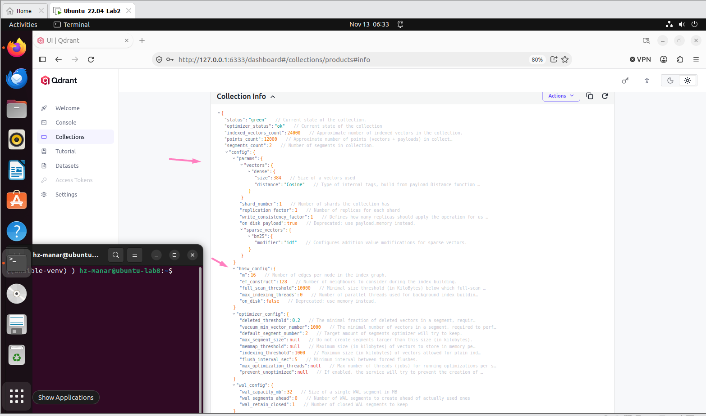

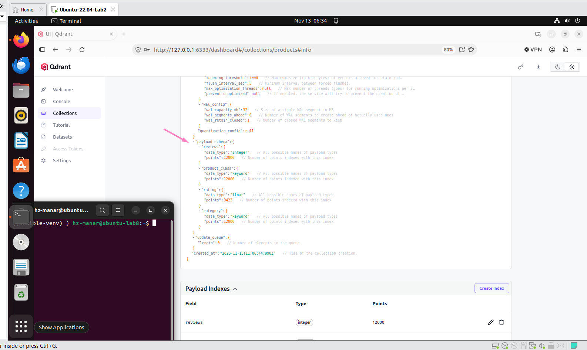

The Info tab confirms the same configuration as the ingest report: Cosine, IDF, HNSW m=16 / ef_construct=128, `indexing_threshold` 1000, and the four payload indexes with the number of indexed points. `rating` has 9,423, because not every product has a rating.

The **Visualize** tab draws the dense vectors in 2D. I took 2,000 products from five categories and coloured them by category:

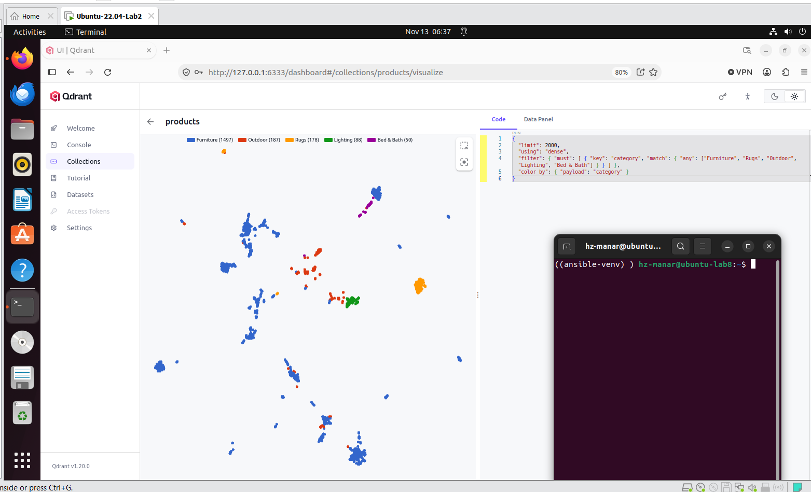

Rugs (orange), Lighting (green) and Bed & Bath (purple) each form their own island, and Furniture (blue) is split into many small groups (beds, tables, chairs). The model never saw the category, it is used only for colours. So the vectors really group products by meaning.

## Metrics and why I chose them

| Metric | Why |
|---|---|
| **nDCG@10** | The standard metric for shop search. It uses graded relevance (Exact = 1, Partial = 0.5) and the position: a good product at place 1 counts more than at place 9 |
| P@5 exact, hit@1 exact, MRR@10 | Simpler to explain. Is the first result right? How many of the first five are exact? |
| HNSW recall@10 vs exact search | How much quality the approximate index loses compared to a full scan |
| RPS and p50 / p95 / p99 | Throughput and the slow tail. The average hides the tail |
| Latency split into `embed` and `qdrant` | To see where the time really goes |
| CPU and RAM of the API and of Qdrant | To find the bottleneck under load |
| Error ratio, targets up | Basic health, used in alerts |
| Points per collection, background optimisations | To see the index being built and the collection size |

## Search quality

`--tags eval` runs the 60 judged queries in the three modes:

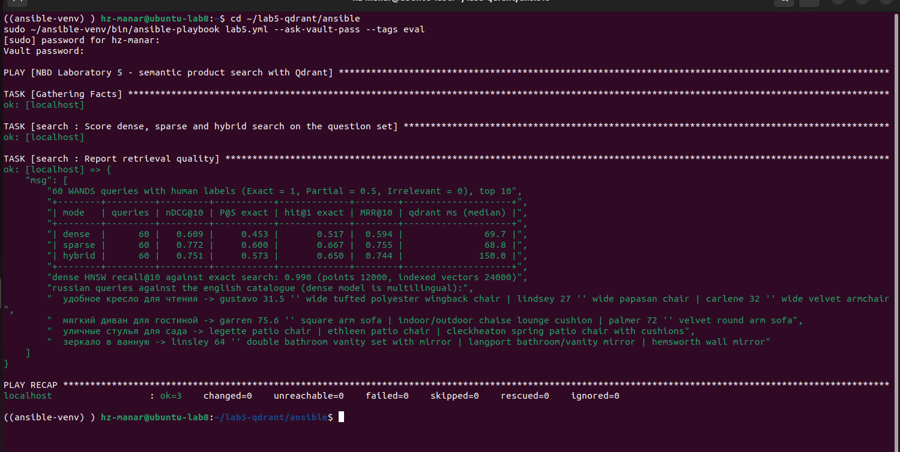

| Mode | nDCG@10 | P@5 exact | hit@1 exact | MRR@10 |
|---|---|---|---|---|
| dense | 0.609 | 0.453 | 0.517 | 0.594 |
| sparse (BM25) | **0.772** | **0.600** | **0.667** | **0.755** |
| hybrid (RRF) | 0.751 | 0.573 | 0.650 | 0.744 |

Honestly, I expected hybrid to win. It did not, and the reason is the data:

- WANDS queries are short and very specific ("turquoise pillows", "platform bed queen"), and the product names contain exactly these words, so BM25 is strong here.
- The small multilingual model alone is clearly weaker on this kind of query.
- But BM25 cannot do the two things the shop needs: Russian queries and queries with other words. Hybrid is only 0.02 nDCG behind BM25 and covers both cases, so it stays the default mode of the API.

The four Russian queries at the end of the report all found the right type of product: reading chairs, sofas, garden chairs and bathroom mirrors.

The HNSW index returns 99% of the same top-10 as an exact full scan (recall 0.990), so the approximate index costs almost nothing in quality here.

The `qdrant ms` column (about 70 ms) is higher than in the later load test. The eval is the first pass over 60 different queries, so most payloads were read from disk for the first time, the same effect as the cold request above.

## Load test

`--tags loadtest` runs three blocks:

- the API in hybrid mode with 1, 2, 4, 8 and 16 parallel clients;
- the three modes with 4 clients;
- Qdrant directly with precomputed vectors, to see the database without the model.

Each stage takes 15 s, and the queries are the 480 real WANDS queries.

### First attempt: the VM was throttled

My first run looked broken:

- 1 client: 8.4 RPS.
- 2 clients: p50 of 3.9 s.
- 8 and 16 clients: every request ran into the 30 s timeout.

But in the same run, a minute later, hybrid with 4 clients gave 23.9 RPS at 111 ms p50. The same load cannot give 17 s and 0.1 s unless the machine itself was the problem.

`uptime` after the test showed a load average of **6.82 / 7.40** on a 4 vCPU VM. At that time:

- Windows was in "Best power efficiency" mode with Battery saver on.
- The battery was at 0% after the shutdown.
- The Qdrant UI was still running its Visualize projection in Firefox inside the VM.

So the VM did not get real CPU time. I switched Windows to "Best performance", closed the Qdrant UI tab, waited until the load average was 0.66 and ran the test again.

### Second attempt

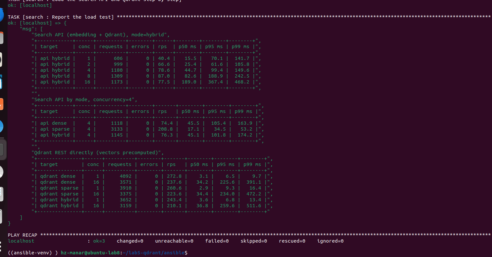

**Search API, hybrid, by number of parallel clients:**

| Clients | RPS | p50 ms | p95 ms | p99 ms | errors |
|---|---|---|---|---|---|
| 1 | 40.4 | 15.5 | 70.1 | 141.7 | 0 |
| 2 | 66.6 | 25.4 | 61.6 | 105.8 | 0 |
| 4 | 78.6 | 44.7 | 99.4 | 149.6 | 0 |
| 8 | **87.0** | 82.6 | 188.9 | 242.5 | 0 |
| 16 | 77.5 | 189.0 | 367.4 | 468.2 | 0 |

The API reaches its maximum at about **87 RPS** with 8 clients. After that more clients only add waiting time: with 16 clients the throughput goes down a little and the latency doubles. With one user, p95 is 70 ms, which meets requirement 4.

**By mode, 4 clients:**

| Mode | RPS | p50 ms | p95 ms |
|---|---|---|---|
| dense | 74.4 | 45.5 | 105.4 |
| sparse | **208.8** | 17.1 | 34.5 |
| hybrid | 76.3 | 45.1 | 101.8 |

Sparse is almost 3 times faster, because it does not need the dense model. Dense and hybrid are almost the same, so the second prefetch and the RRF merge inside Qdrant cost practically nothing. The cost is the dense embedding.

**Qdrant directly (vectors already computed):**

| Mode | 1 client RPS / p50 | 16 clients RPS / p50 |
|---|---|---|
| dense | 272.8 / 3.1 ms | 237.6 / 34.2 ms |
| sparse | 260.6 / 2.9 ms | 223.6 / 34.4 ms |
| hybrid | 243.4 / 3.6 ms | 210.1 / 36.8 ms |

Qdrant alone answers in about 3 ms and handles more than 200 RPS even with 16 clients on the same 4 vCPU.

### What Grafana showed during the test

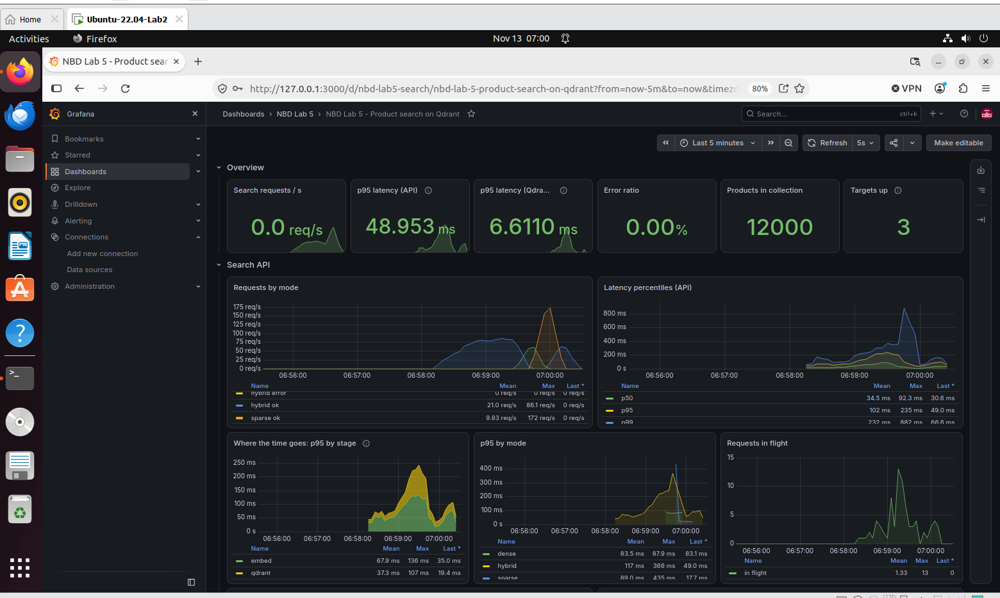

The overview: p95 of the API 49 ms, p95 of the Qdrant query endpoint 6.6 ms, error ratio 0%, 12,000 products, 3 targets up. "Where the time goes" shows the embed stage above the Qdrant stage for the whole test (mean 68 ms against 37 ms).

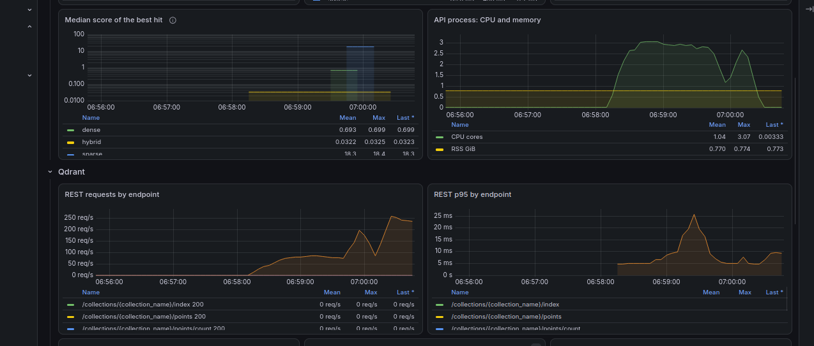

The API process went up to **3.07 CPU cores out of 4**, with RAM flat at 0.77 GB. The Qdrant REST rate reached about 250 requests per second during the direct stage, with p95 under 25 ms.

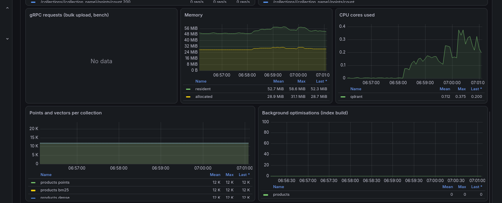

Qdrant itself used at most **0.375 cores** and about 56 MiB of RAM, and there were no background optimisations during the test.

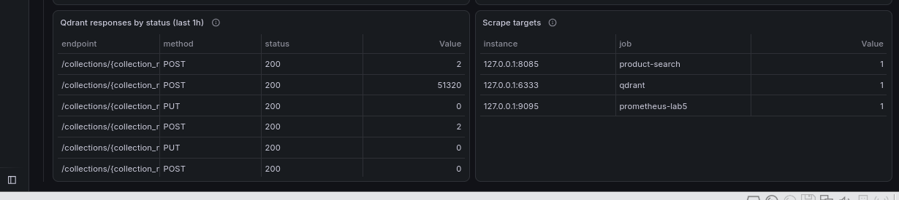

**Conclusion of the load test.** The bottleneck is turning text into a vector on the CPU, not the database. Qdrant was almost idle while the API used three cores. To make the service faster I would:

- use a quantized or smaller ONNX model, or a GPU;
- run several API instances behind a balancer;
- cache embeddings of popular queries.

Qdrant itself does not need any changes for this load.

## HNSW and quantization on 100k vectors

The product collection is small, so to see the index trade-offs on a bigger scale, `--tags bench` creates a separate collection `bench`:

- 100,000 synthetic clustered vectors, 384 dims, uploaded over gRPC;
- the ground truth comes from an exact numpy brute force;
- it measures recall@10 and latency for different `hnsw_ef` values, then switches on scalar int8 quantization and measures again with and without rescoring.

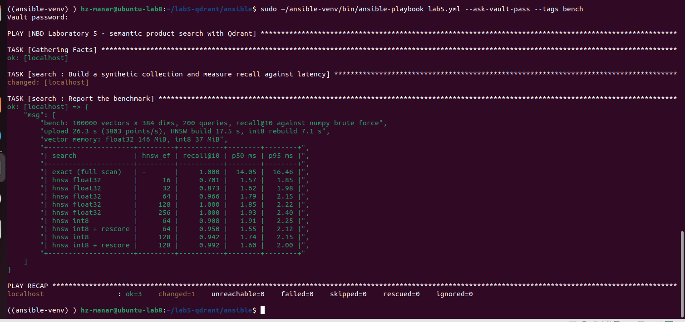

Setup: upload took 26.3 s (3,803 points/s), building HNSW took 17.5 s, rebuilding with int8 took 7.1 s.

| Search | hnsw_ef | recall@10 | p50 ms | p95 ms |
|---|---|---|---|---|
| exact (full scan) | - | 1.000 | 14.05 | 16.46 |
| HNSW float32 | 16 | 0.701 | 1.57 | 1.85 |
| HNSW float32 | 32 | 0.873 | 1.62 | 1.98 |
| HNSW float32 | 64 | 0.966 | 1.79 | 2.15 |
| HNSW float32 | 128 | **1.000** | 1.85 | 2.22 |
| HNSW float32 | 256 | 1.000 | 1.93 | 2.40 |
| HNSW int8 | 64 | 0.908 | 1.91 | 2.25 |
| HNSW int8 + rescore | 64 | 0.950 | 1.55 | 2.12 |
| HNSW int8 | 128 | 0.942 | 1.74 | 2.15 |
| HNSW int8 + rescore | 128 | **0.992** | 1.60 | 2.00 |

What I take from it:

- HNSW with `ef=128` gives the same top-10 as a full scan, **7.6 times faster** (1.85 ms against 14.05 ms).
- `hnsw_ef` is the quality knob. At 16 the search is only a little faster, but recall falls to 0.70.
- int8 quantization makes the vectors 4 times smaller (146 MiB → 37 MiB) and loses a few points of recall. With rescoring on the original vectors, recall comes back to 0.992 at the same speed.
- For a catalogue in the millions I would use int8 with rescoring and `ef` around 128.

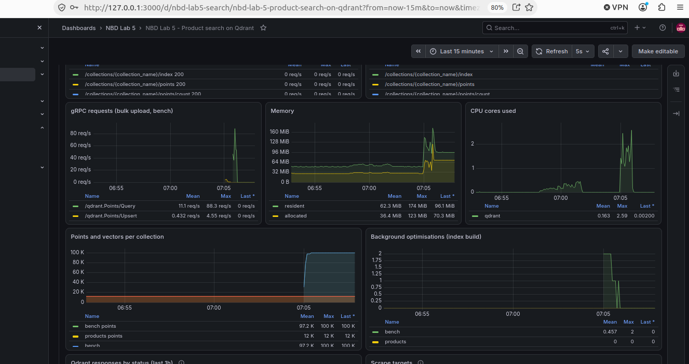

In Grafana the bench is easy to see:

- gRPC Upsert during the upload, then gRPC Query up to 88 requests per second during the measurement;
- Qdrant memory going up to 174 MiB;
- CPU up to 2.6 cores while the graph was built;
- two background optimisations (HNSW, then int8);
- the `bench` collection with 100K points next to `products` with 12K.

## Backup

`--tags snapshot` asks Qdrant for a snapshot of `products`, using the admin key:

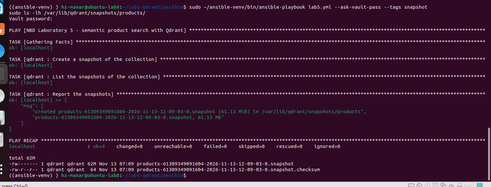

The result is one file of 61 MiB plus a `.checksum`, owned by `qdrant` with mode 0600. With this file the collection can be restored on this or another server without embedding the 12,000 products again, which would take 7 minutes.

## Monitoring and alerts

The scrape interval is 5 s, because otherwise a 15 s load test stage is only three points on a graph.

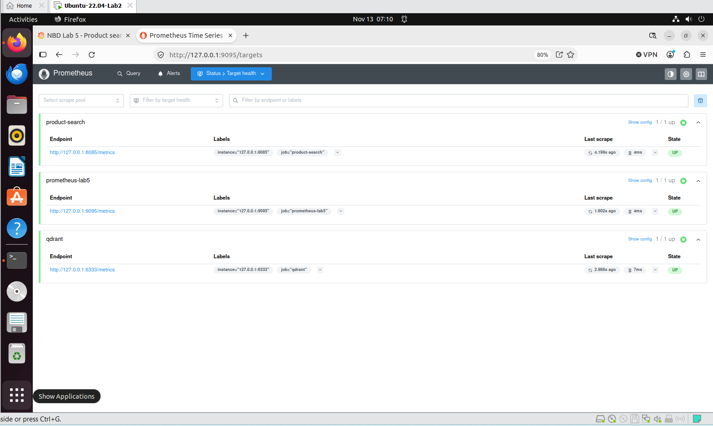

Four recording rules prepare the main series: RPS by mode, p95 by stage, error ratio, p95 of the Qdrant query endpoint. Five alerts cover the failures I care about:

| Alert | Condition |
|---|---|
| QdrantDown | `up{job="qdrant"} == 0` for 30 s |
| SearchApiDown | `up{job="product-search"} == 0` for 30 s |
| SearchLatencyHigh | API p95 > 250 ms for 2 min |
| SearchErrors | more than 1% failed searches for 1 min |
| CollectionEmpty | `products` has 0 points for 1 min |

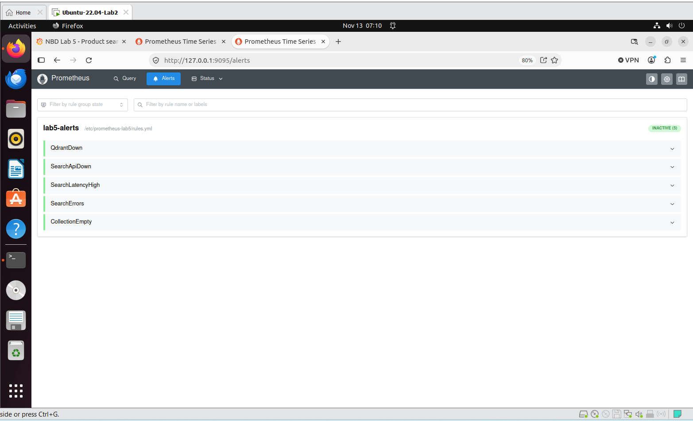

### Failure test

I stopped Qdrant with `systemctl stop qdrant` and sent a search. The API did not crash. It answered with a clear `503` and `search failed: ResponseHandlingException`, and counted the error. About a minute later QdrantDown was firing:

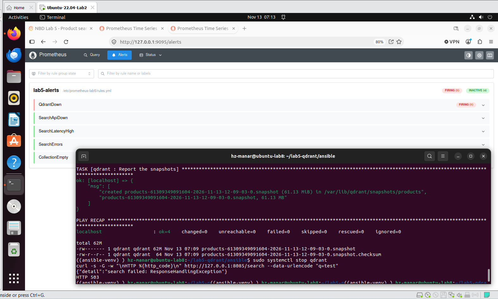

Grafana showed 2 targets up instead of 3, and the failed hybrid request in "Requests by mode":

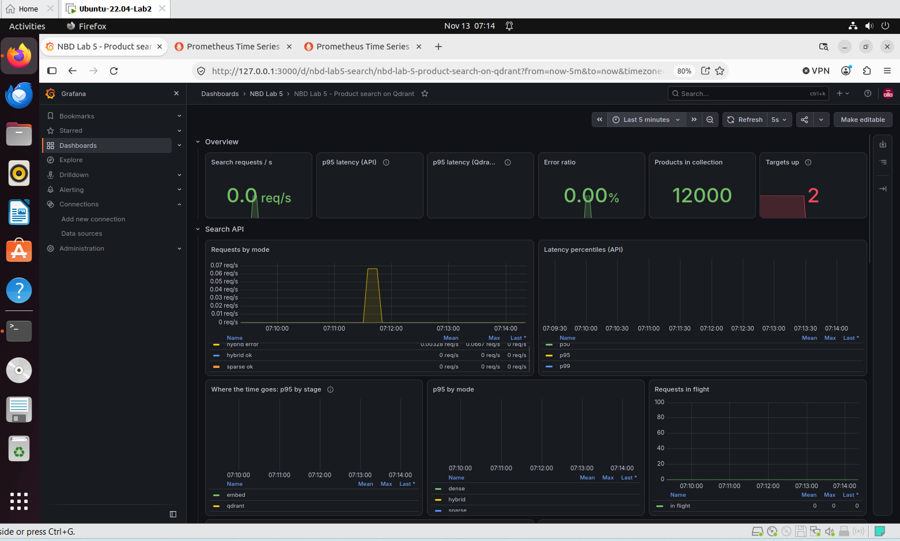

After `systemctl start qdrant` the API was healthy again with all 12,000 points, and the alert went back to inactive. Qdrant writes everything to the WAL and to disk, so a restart loses nothing:

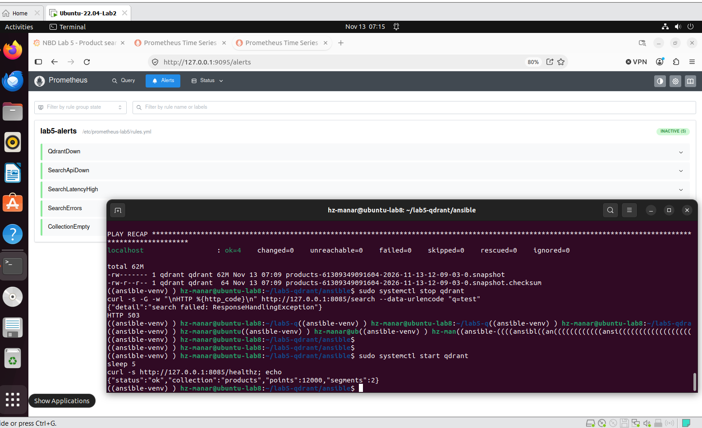

## Repository structure

```
lab5-qdrant/
├── ansible/
│   ├── lab5.yml                      playbook, tags part1..part4, eval, loadtest, bench, snapshot
│   ├── ansible.cfg, inventory.ini, .ansible-lint
│   ├── group_vars/all/vault.yml.example
│   └── roles/
│       ├── common/                   shared variables (ports, paths, keys from vault)
│       ├── qdrant/                   install, config, systemd, access check, snapshot
│       ├── ingest/                   venv, models, WANDS download, ingest, data report
│       ├── search/                   API service, checks, eval, load test, bench
│       └── monitoring/               Prometheus Lab 5, rules, Grafana provisioning
├── app/
│   ├── requirements.txt
│   └── shopsearch/                   catalogue, encoder, store, api, evaluate, loadtest, bench, CLI
├── dashboards/search.json
└── docs/screenshots/
```

How to run it:

```bash
cd ansible
cp group_vars/all/vault.yml.example group_vars/all/vault.yml
ansible-vault encrypt group_vars/all/vault.yml
sudo ~/ansible-venv/bin/ansible-playbook lab5.yml --ask-vault-pass
sudo ~/ansible-venv/bin/ansible-playbook lab5.yml --ask-vault-pass --tags eval
sudo ~/ansible-venv/bin/ansible-playbook lab5.yml --ask-vault-pass --tags loadtest
sudo ~/ansible-venv/bin/ansible-playbook lab5.yml --ask-vault-pass --tags bench
sudo ~/ansible-venv/bin/ansible-playbook lab5.yml --ask-vault-pass --tags snapshot
```

Edit `vault.yml` with your own keys before encrypting it. `vault.yml` itself is in `.gitignore`, and the WANDS files and the models are downloaded on the VM, so they are not in the repository either.

## What I learned

- A vector database is only half of semantic search. The other half is the model, and in my case the model was 3 times more expensive than the database under load.
- "Semantic search is better" is not automatically true. On short shop queries BM25 won. The numbers made me keep hybrid for the right reason (Russian queries and other words), not because it sounds modern.
- HNSW gives full-scan quality at a fraction of the time if `ef` is chosen with a measurement, and quantization with rescoring is almost free in quality.
- A load test is worthless if the machine under it is not stable. I would not have noticed it without comparing two blocks of the same run and looking at `uptime`.
- Separate keys for reading and writing are a cheap and strong protection: the service that faces users simply cannot delete anything.

## Limitations

- One Qdrant node, no replication. Qdrant supports a Raft cluster with replicated shards, which would be the next step.
- The catalogue is 12,000 of 43,000 products because embedding on the VM CPU is slow. The bench shows how the index behaves at 100k.
- The dense model is a small general multilingual model. A model trained for e-commerce search, or fine-tuned on WANDS, would probably beat BM25.
- Qdrant runs without TLS, because everything is bound to 127.0.0.1. Anything reachable from a network would need TLS.
